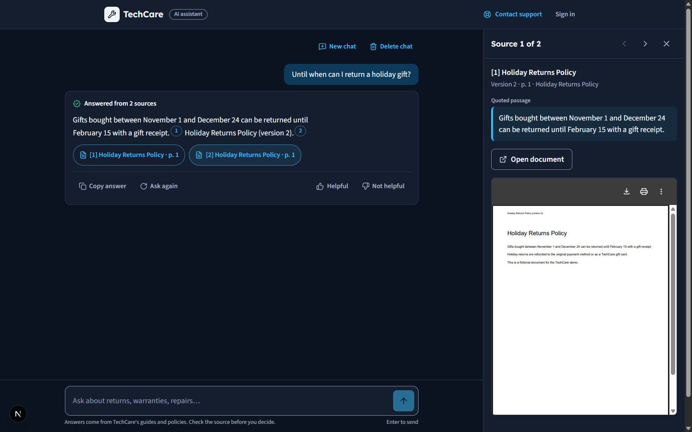
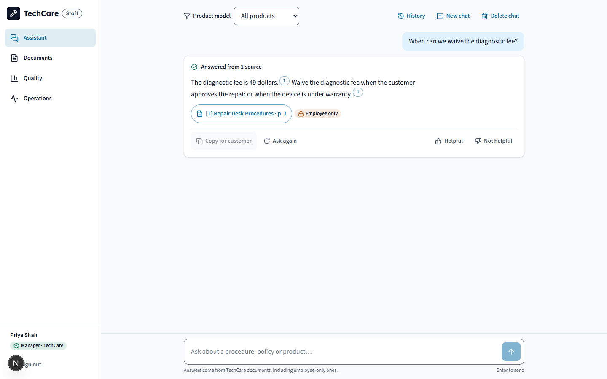
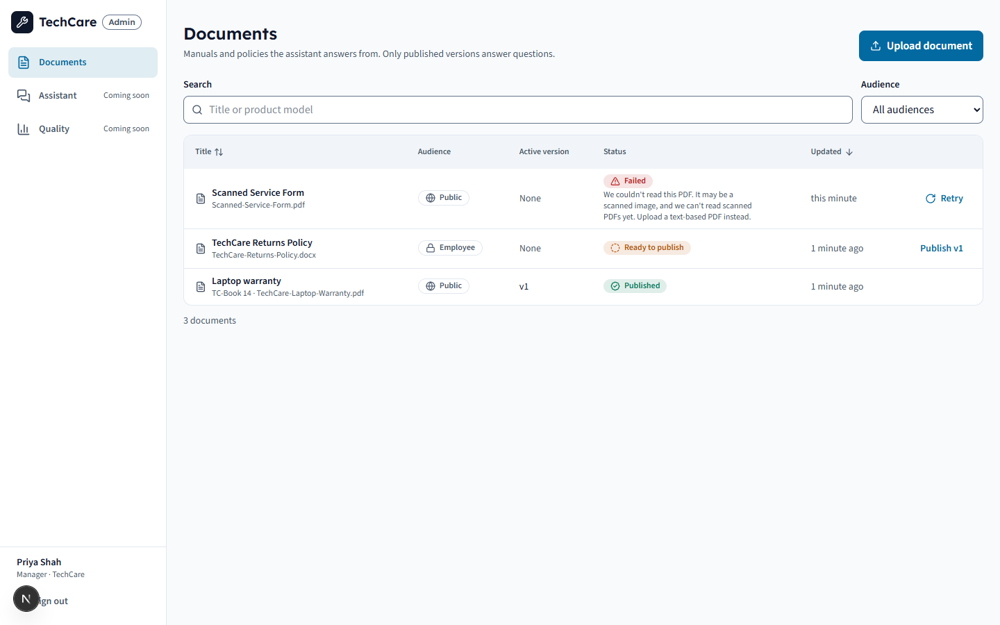
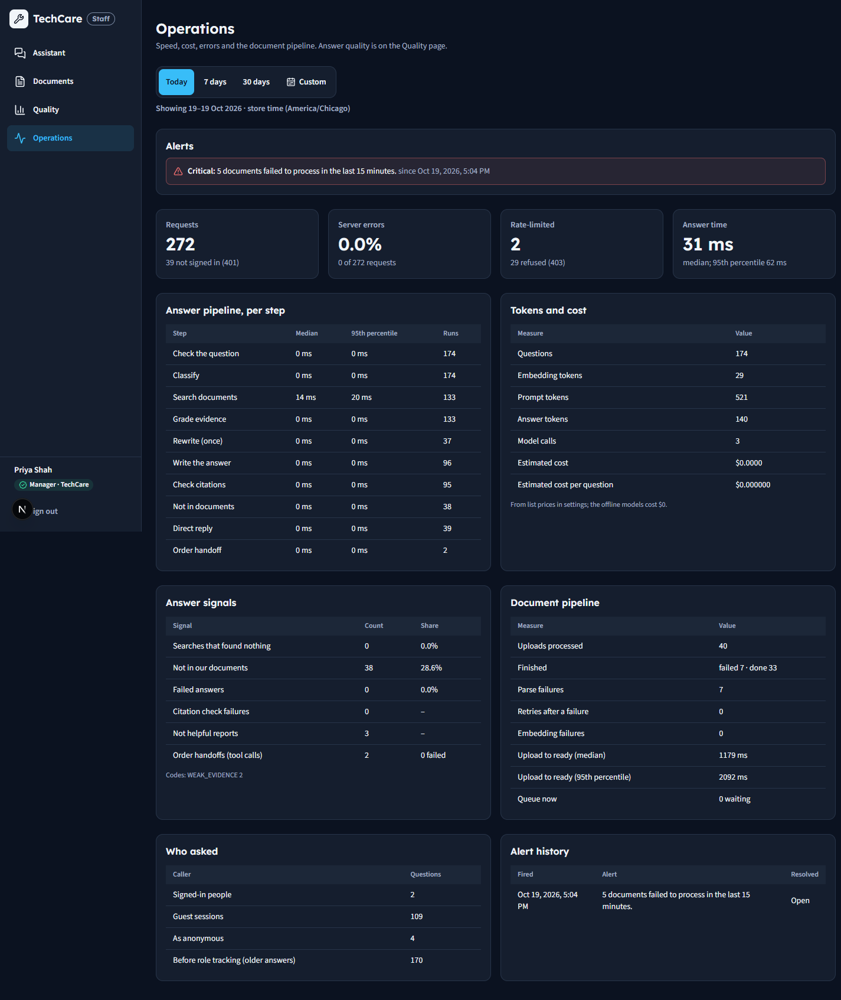
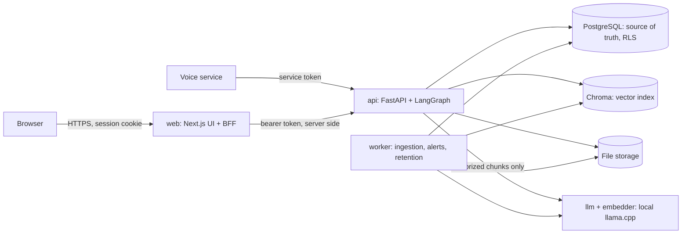

# KnowledgeAI

A retrieval-augmented knowledge base for **TechCare**, a fictional electronics retailer. It answers customer and
employee questions from approved documents, cites the exact page, and says honestly when it doesn't know.

> **Status:** MVP built. It answers with **local open-weight models** (Qwen3-4B-Instruct-2507 and
> nomic-embed-text-v1.5 through llama.cpp, in [LLM/](LLM/README.md)): no paid API, no per-question cost. It has
> release images, a rehearsed deployment, and a Definition of Done audit (16 of 18 met:
> [docs/definition-of-done.md](docs/definition-of-done.md)). All §19 decisions are made (ADR-026, ADR-027).
> Not yet done: the first CI run on GitHub, the VM itself, and order and ticket integrations (P1).
> Demo video (3 min, captioned): [docs/demos/18-demo-scenarios.mp4](docs/demos/18-demo-scenarios.mp4).
> Stack: FastAPI · LangGraph · ChromaDB · PostgreSQL · Next.js 16 (pinned in [docs/dependency-versions.md](docs/dependency-versions.md)).

| Customer chat, cited | Employee assistant | Document center | Operations |
| --- | --- | --- | --- |
|  |  |  |  |

## What it does

- **Cited answers.** Every sentence that uses a document carries a numbered citation; the source panel shows the
  quoted passage, the page and the version, and opens the original.
- **"Not in our documents"** instead of guessing, whenever the evidence is weak. Citations are validated: an invented
  source, quote or link never reaches the user.
- **Two audiences.** Customers see public documents; employees also see internal procedures, marked
  *Employee only*. The filter is applied before any text reaches the model, and tested with 96 access probes.
- **Versioned documents.** Upload, process, review and publish; publishing a new version retires the old one from
  answers at once.
- **Document center** for managers: upload with progress, versions, chunk diagnostics, activity log, delete.
- **Quality and Operations dashboards:** unanswered questions, feedback, latency per step, tokens and cost, errors,
  ingestion pipeline, alerts.
- **Voice-ready API** (`knowledge-answer.v1`) for the separate voice project, with its own scoped credential.

## Architecture



A question goes through one LangGraph workflow: validate → classify intent → retrieve (tenant + audience +
active-version filter) → grade evidence → rewrite once if needed → generate → validate citations → persist the
trace. Details, data flows and the 27 decision records: [docs/architecture.md](docs/architecture.md).

## Run it

Prerequisites: Docker Desktop. For development also Python 3.12 and Node.js 24 LTS.

```bash
cp .env.example .env            # then replace both secrets (the command is in the file)
```

**Everything in containers** (production images, development settings, the local models):

```bash
backend/.venv/Scripts/python scripts/download_models.py   # once: 2.6 GB into LLM/models/, checksums verified
docker compose --profile app up -d --build    # migrates, then starts the models, api, worker and web
# with an NVIDIA GPU: docker compose -f compose.yaml -f compose.gpu.yaml --profile app up -d --build
docker compose exec api python -m app.ingestion.rebuild   # index existing documents for the local embedder
# web: http://127.0.0.1:13000   api: http://127.0.0.1:18000/api/v1/health
docker compose --profile app run --rm api python -m app.cli.seed   # demo users; passwords are printed once
```

**For development** (hot reload):

```bash
docker compose up -d            # Postgres on 127.0.0.1:55432, Chroma on 127.0.0.1:8001

cd backend
python -m venv .venv
.venv/Scripts/python -m pip install -c constraints.txt -e ".[dev]"   # macOS/Linux: .venv/bin/...
.venv/Scripts/alembic upgrade head          # schema (runs as the owner role)
.venv/Scripts/python -m app.cli.seed        # TechCare + one user per role → data/dev-credentials.txt
.venv/Scripts/python -m app.cli.seed_orders # fictional products, customers and orders (US-05)
.venv/Scripts/fastapi dev                   # API on http://127.0.0.1:8000
.venv/Scripts/python -m app.ingestion.worker   # second terminal: processes uploads

cd ../frontend
npm ci
npm run dev                     # http://127.0.0.1:3000 → sign in at /login, or chat as a guest at /chat
```

Development and the test suite use the deterministic offline models (`LLM_PROVIDER=fake` in `.env`). To use the
local models from `fastapi dev`, start them (`docker compose --profile llm up -d`) and set the "Local models"
block in `.env.example`.

The API refuses to start if a secret is missing or still a placeholder, and refuses staging/production settings
without TLS, S3 and a real malware scanner. That's intended.

Sample documents: `backend/.venv/Scripts/python scripts/make_demo_docs.py` writes fictional files to `data/demo-docs/`.

## Configuration

All settings, with defaults and comments, are in [.env.example](.env.example). The ones you'll touch:

| Variable | Purpose |
| --- | --- |
| `APP_ENV` | `development` · `test` · `staging` · `production` (deployed environments get stricter checks) |
| `DATABASE_URL` / `MIGRATION_DATABASE_URL` | App role (subject to RLS) / schema owner for migrations |
| `CHROMA_HOST`, `CHROMA_PORT` | Vector index |
| `STORAGE_BACKEND` | `local` (dev) or `s3` (required when deployed) |
| `LLM_PROVIDER`, `LLM_MODEL`, `LLM_BASE_URL`, `EMBEDDING_*` | `local` (the llama.cpp servers, no key), `fake` (offline, deterministic, for tests) or `openai`; changing the embedding model needs a new collection and a rebuild |
| `AUTH_JWT_SECRET`, `INTERNAL_SERVICE_TOKEN` | Secrets (≥ 32 chars; generate them) |
| `PUBLIC_ORGANIZATION`, `INTERNAL_SERVICE_ORGANIZATION` | Which tenant guests and the voice service talk to |
| `RATE_LIMIT_*`, `MAX_UPLOAD_BYTES`, … | Limits (§11) |
| `ALERT_*`, `METRICS_*`, `LLM_PRICE_*` | Alerts, metrics retention, cost estimates (§13) |

## Scripts and commands

| Task | Command |
| --- | --- |
| Backend checks | `cd backend; .venv/Scripts/ruff check .; .venv/Scripts/ruff format --check .; .venv/Scripts/mypy app tests` |
| Backend tests | `cd backend; .venv/Scripts/python -m pytest` (integration tests need `docker compose up -d`) |
| Frontend checks | `cd frontend; npm run lint; npm run typecheck; npm test; npm run build` |
| Golden evaluation gates | `cd backend; .venv/Scripts/python -m app.evaluation.runner --dataset ../evaluation/golden_questions/golden-v1.yaml --corpus golden --organization techcare-golden --setup --load-corpus --suites core,access,lifecycle` |
| Load test (G9) | `cd backend; .venv/Scripts/python -m app.evaluation.load` (setup: [docs/operations.md §11](docs/operations.md)) |
| API contracts | `cd backend; .venv/Scripts/python -m app.cli.contracts` (`--write` after a reviewed change) |
| Rebuild the vector index | `cd backend; .venv/Scripts/python -m app.ingestion.rebuild` |
| Backup with a restore check | `backend/.venv/Scripts/python scripts/db_backup.py backup --verify` |
| Local models | `backend/.venv/Scripts/python scripts/download_models.py` (`--check` to verify only) |
| Dependency lock | `backend/.venv/Scripts/python scripts/lock_backend.py` (never edit `constraints.txt` by hand) |

## Testing and quality

- **Backend:** unit tests and integration tests against real Postgres and Chroma; CI also runs migrations, the API
  contracts, secret scanning and dependency audits ([.github/workflows/ci.yml](.github/workflows/ci.yml)).
- **Evaluation:** 142 frozen golden questions, 96 access probes and 12 version-lifecycle scenarios run inside the
  test suite, failing the build on any gate. Latest run on the substitute models: retrieval 98/98, invented answers
  0/36, valid citations 109/109, unauthorized exposure 0/96, old-version citations 0/12; 95 of 98 answerable
  questions fully right. On the local models every gate passes as well (citations 103/103); 89 of 98 match word
  for word, and 7 of the 9 misses are correct paraphrases ([docs/evaluation-report.md](docs/evaluation-report.md) §4a). The failures and limits are listed in [docs/demos/12-evaluation.md](docs/demos/12-evaluation.md)
  and [docs/demos/14-15-repository-release.md](docs/demos/14-15-repository-release.md).
- **Evidence:** every ticked item in the plan links to tests, a manual run and screenshots in [docs/demos/](docs/demos/).

## Deployment

The containers (`backend/Dockerfile`, `frontend/Dockerfile`, `compose.yaml` profile `app`) are the release
artifacts: one backend image runs the API, the worker and migrations; the web image is Next.js standalone.
The chosen host is one Linux VM running Docker Compose with the local models (ADR-027).
[docs/deployment.md](docs/deployment.md) covers that setup (§1a), what any host must provide (Postgres, storage,
ClamAV, TLS, a secret store), how to release and roll back, and how to check a deploy:

```bash
backend/.venv/Scripts/python scripts/rehearse_deploy.py     # the whole thing locally, TLS everywhere: 12 checks
cd backend; .venv/Scripts/python -m app.cli.smoke --base-url <api>   # after every real deploy
```

## Not built (by design or not yet)

| Feature | Priority | Status |
| --- | --- | --- |
| Staging/production deployment | M7 | Host chosen (one VM with Compose, ADR-027); images, the local models, S3 storage, per-service accounts and the rehearsal are ready; the VM isn't provisioned |
| Order status lookup, support tickets | P1 | Order questions get a "contact support" handoff |
| OCR for scanned PDFs | P1 | Scans are rejected with a clear message |
| Conflict detection between documents, hybrid search, reranking, metadata search | P1 | Conflicting sources are never blended; only the product-model filter exists |
| Bangla and other languages | P1 | English only |
| SSO/MFA, URL ingestion, CRM, recommendations | P2 | Not scheduled |

## Documents

| File | Purpose |
| --- | --- |
| [docs/IMPLEMENTATION_PLAN.md](docs/IMPLEMENTATION_PLAN.md) | Requirements, design, test plan and release checklist (source of truth) |
| [docs/product-vision.md](docs/product-vision.md) · [docs/scope.md](docs/scope.md) | Personas, stories, permissions · MVP cut line and priorities |
| [docs/architecture.md](docs/architecture.md) | Containers, flows, decision records, the §19 decisions |
| [LLM/README.md](LLM/README.md) | The local models: what, why, how to get and run them |
| [docs/api-contract.md](docs/api-contract.md) · [docs/contracts/](docs/contracts/) | HTTP API with sample requests · OpenAPI and the voice contract |
| [docs/threat-model.md](docs/threat-model.md) | Threats, controls and the tests that prove them |
| [docs/data-model.md](docs/data-model.md) | Tables, row-level security, Chroma metadata, version lifecycle |
| [docs/evaluation.md](docs/evaluation.md) | Acceptance gates G1–G10 ([evaluation/gates.yaml](evaluation/gates.yaml)) |
| [docs/operations.md](docs/operations.md) | Runbook: health, backups, rebuild, retention, alerts, incidents, load test |
| [docs/deployment.md](docs/deployment.md) | Deploying: what to provision, secrets, release, rollback, smoke test |
| [docs/evaluation-report.md](docs/evaluation-report.md) | Quality numbers, failures and limitations |
| [docs/risk-register.md](docs/risk-register.md) · [docs/definition-of-done.md](docs/definition-of-done.md) | Risks with their mitigations and tests · the §18 audit |
| [docs/repository.md](docs/repository.md) | Where everything lives |
| [design-system/MASTER.md](design-system/MASTER.md) | UI tokens, components, accessibility checklist |
| [docs/demos/](docs/demos/) | Evidence for each plan section |

## How work is tracked

- **Priorities:** `P0` required MVP · `P1` production-oriented improvement · `P2` optional stretch.
- **Done means evidence:** a plan box is ticked only with automated tests, a manual test, and a screenshot or demo
  (enforced by the PR template). A UI existing is not completion.
- **Finished means** every item in the Definition of Done (plan §18) passes.
- **Standalone:** this project runs without the voice project ([ADR-001](docs/architecture.md)).
- **Data:** all documents and people are fictional. Never commit `.env` or real keys.
