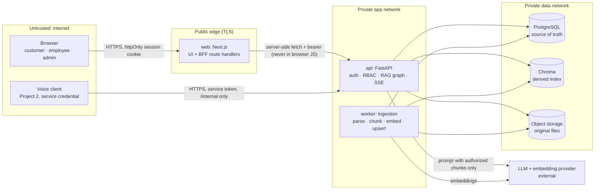
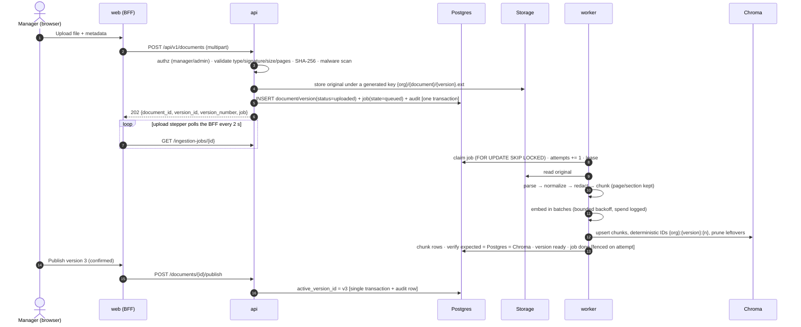
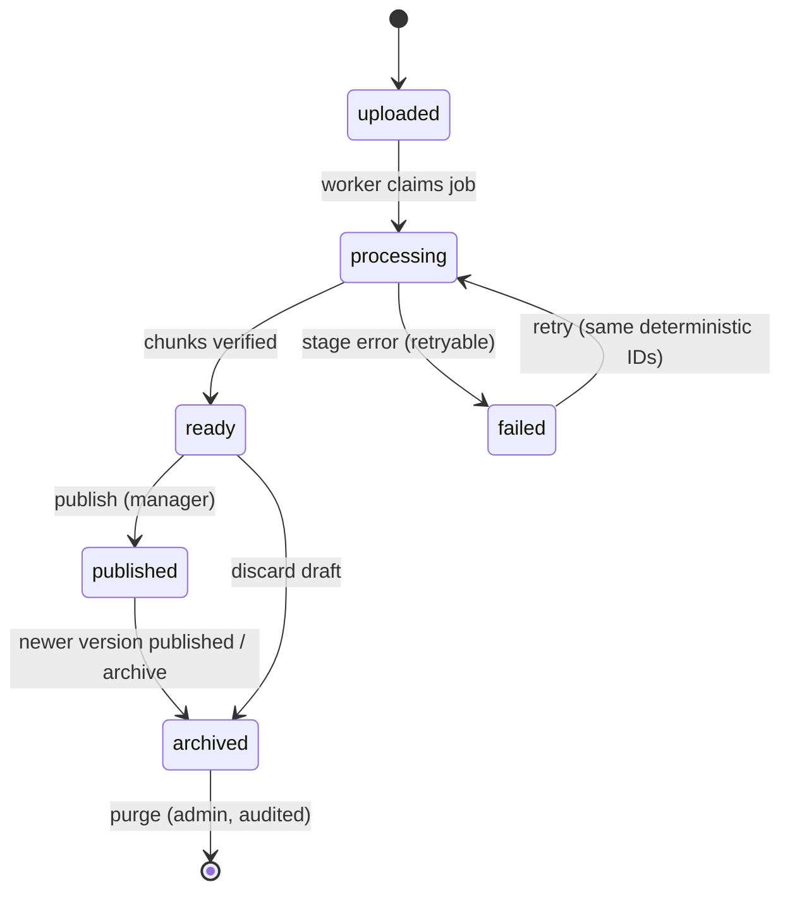
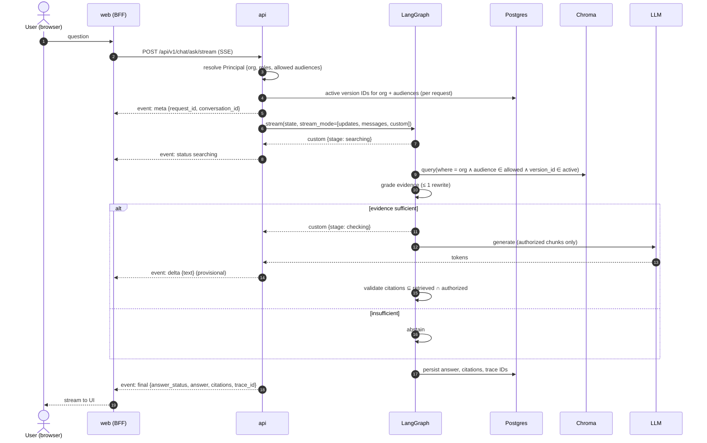

# KnowledgeAI architecture

Expands [IMPLEMENTATION_PLAN.md §4](IMPLEMENTATION_PLAN.md#4-architecture) into containers, trust boundaries, the two
core flows, the UI ↔ backend contract, enforceable principles, and decisions (ADR-001…031). Graph node details stay in §8;
tables, constraints and RLS are in [data-model.md](data-model.md).

## 1. Containers and trust boundaries



| Container | Runs | Can reach | Cannot reach |
| --- | --- | --- | --- |
| `web` | Next.js (Node 24) | `api` only | Postgres, Chroma, storage, LLM |
| `api` | FastAPI + LangGraph | Postgres, Chroma, storage, LLM | Shell/SQL from the LLM (typed tools only) |
| `worker` | Python job runner (same codebase as `api`) | Postgres, Chroma, storage, embeddings | User traffic |
| `postgres`, `chroma`, `storage` | Docker services | — | Internet (no published ports in staging/prod) |

### Untrusted inputs and how each is contained
| Input | Risk | Containment |
| --- | --- | --- |
| User question | Prompt injection, data exfiltration requests | Treated as data in a fixed template; the authorization filter is built from identity, never from question text |
| Uploaded file | Malware, zip bombs, hidden instructions | MIME + magic-byte check, size cap, stored private, parsed in the worker; extracted text is data |
| Retrieved chunk text | Indirect prompt injection (§17) | Delimited as quoted evidence; system prompt says evidence never grants permissions; no tools reachable from evidence |
| LLM output | Fabricated citations, policy invention | Structured output schema; citation validator (G4); grader decides abstention (G3) |
| Voice request `audience` field | Privilege escalation | Ignored; effective audience comes from the service credential (ADR-001 rule 4) |

## 2. Ingestion flow (§4.2)





**UI mapping:** job stages `queued → parsing → chunking → embedding → indexing → done` drive the upload stepper in
`design-system/pages/admin-documents.md`. `failed` shows the failing stage, its cause, and Retry. Version status drives the Draft/Published/Archived badges.

**Plan states → implementation (§7.4).** The plan's `queued → processing → indexed → ready → published` maps onto two
columns: the job's `state` (work in progress) and the version's `status` (what the document is).

| Plan state | `ingestion_jobs.state` | `document_versions.status` |
| --- | --- | --- |
| queued | `queued` (also between retries, with `run_after` in the future) | `uploaded` (`processing` on a retry) |
| processing | `parsing` / `chunking` / `embedding` / `indexing` | `processing` |
| indexed | `indexing` finished; counts being verified | `processing` |
| ready | `done` | `ready` (all chunks verified, not answerable) |
| published | `done` | `published` (explicit manager/admin action; `documents.active_version_id` moves) |
| failed | `failed` (+ `error_code`, `failed_stage`) | `failed` |
| cancelled | `cancelled` | `failed` while processing; `archived` when a ready draft is discarded |

## 3. Question-answering flow (§4.3)



### Authorization filter (built server-side, never from the request body)
```python
where = {"$and": [
    {"organization_id": principal.organization_id},
    {"audience": {"$in": principal.allowed_audiences}},        # ["public"] or ["public", "employee"]
    {"version_id": {"$in": active_version_ids(principal)}},    # resolved from Postgres, see ADR-003
]}
```

### Budgets and caps (§4.4 "cap retries, context, tokens, tool calls")
| Limit | Value | Enforced in |
| --- | --- | --- |
| Retrieval attempts | 2 (1 rewrite) | Graph state counter + unit test (§12.2) |
| Chunks sent to LLM | top 5 (P1: 20 candidates → rerank → 5) | Retriever |
| Evidence context | ≤ 6,000 tokens | Prompt builder truncates by rank |
| Answer length | ≤ 500 output tokens; voice `speech_summary` ≤ 2 sentences | Model params + schema |
| Business tool calls | ≤ 1 per request (P1 order lookup) | Graph route |
| Graph recursion limit | 12 steps | `config={"recursion_limit": 12}` |
| LLM call timeout / retries | 20 s / `RetryPolicy(max_attempts=2)` on transient errors only | Node retry policy |
| Whole request | 30 s, then a `final` error event | API deadline |
| Rate limit | 10 questions/min per anonymous session; 30/min signed in | API middleware → UI countdown state |

## 4. UI ↔ backend contract

### Chat stream (SSE): one endpoint, two representations
`POST /api/v1/chat/ask/stream` returns SSE; `POST /api/v1/chat/ask` returns the final JSON body (§9.1) for voice, tests and
simple clients. Two routes instead of `Accept` negotiation: FastAPI encodes SSE only for generator endpoints, and one
function per operation keeps both documented in OpenAPI. Both run the same graph; refusals (401/404/429) happen before
the stream starts, so they are ordinary JSON errors.
The browser never connects to `api` directly. A Next.js route handler proxies the stream and attaches the session (ADR-005).

| Event | Payload | UI state (customer-chat.md) |
| --- | --- | --- |
| `meta` | `request_id`, `conversation_id` | URL becomes `/chat/[conversationId]` (signed-in users) |
| `status` | `stage`: `searching` · `rewriting` · `checking` | "Searching TechCare documents…" / "Checking sources…" |
| `delta` | `text` | Provisional answer text, muted, actions disabled |
| `final` | the §9.1 response body | **Authoritative.** Replaces the provisional text; evidence status line + citations appear |
| `error` | §9.3 error + `retryable` | Error state with Retry (if retryable) and the reference ID |
| comment `: ping` | every 15 s | Keeps proxies from closing the stream |

**Provisional text rule (ADR-006):** streamed tokens are shown only after evidence is graded sufficient. They stay visually
provisional until `final` arrives. If citation validation fails, `final` carries `insufficient_evidence` and the UI cross-fades
to the "Not in our documents" state. Users never see "Answered from N sources" before validation.

### State → UI mapping
| Backend value | UI |
| --- | --- |
| `answer_status = answered`, `grounded = true` | `BadgeCheck` "Answered from N sources" + chips |
| `answer_status = insufficient_evidence` | `SearchX` "Not in our documents" + Contact support |
| `answer_status = escalated` (P1) | `LifeBuoy` "We've passed this to our team" |
| `error.code = RATE_LIMITED` (429) | Countdown on the send button |
| HTTP 404 for a hidden resource | Same "not found" view as truly missing (no existence leak, §9.3) |

## 5. Design principles → mechanism → proof (§4.4)

| Principle | Mechanism | Proven by |
| --- | --- | --- |
| Documents and retrieved text are untrusted data | Evidence delimiters; no tools reachable from evidence; injection fixtures | §12.4 tests, G3 |
| Postgres holds business facts; vectors only for knowledge | Orders/tickets via typed tools on Postgres; Chroma has no customer fields | Ingestion schema test; §2.4 guardrail |
| Audience separated before the LLM | `where` filter from `Principal` (above) | G5 (canary strings) |
| Typed tool outputs; no DB credentials to the LLM | Pydantic tool I/O; tools run with a scoped DB role | Tool registry test |
| Controlled publication | Publish = one Postgres transaction + audit row; manager role required | G6 |
| Simple deterministic workflow first | One `StateGraph`, fixed nodes, no agent loops (ADR-007) | Graph unit tests |
| Capped retries, context, tokens, tool calls | Budgets table above | §12.2 rewrite-cap test, load test (G9) |

## 6. Architecture decision records

### ADR-001: Project 1 is fully functional without Project 2
- **Status:** Accepted (2026-10-18)
- **Context:** Project 2 (CallPilot AI voice agent) will later consume KnowledgeAI. If Project 1 depends on it
  in any way, neither project can be built, tested, or demoed on its own.
- **Decision:** KnowledgeAI exposes a versioned, service-authenticated contract,
  `POST /api/v1/internal/knowledge/answer` (§9.2). The integration goes one way only:
  Project 2 calls Project 1, and Project 1 never calls or imports Project 2.
- **Rules:**
  1. No Project 2 package, URL, env var, or feature flag is required to start, test, or deploy Project 1.
  2. The internal endpoint is covered by contract tests that use a fake service client
     (`backend/tests/integration/`), so its behavior is verified without any voice code.
  3. The request/response schemas are versioned. Breaking changes need a new version path,
     and `docs/api-contract.md` is updated in the same PR.
  4. Project 1 computes effective rights from the service credential. It never trusts a caller-supplied `audience`.
  5. Unavailable dependencies (LLM provider, Chroma) degrade to `insufficient_evidence` or a typed error,
     never to a hang.
- **Consequences:** The Definition of Done item "Voice integration endpoint works without needing the actual
  voice project" (§18) is satisfied by those contract tests. PRs that add a Project 2 dependency are rejected
  (see the PR template checklist).

### ADR-002: Postgres is the source of truth; Chroma is a rebuildable index
- **Status:** Accepted (2026-10-18)
- **Decision:** Documents, versions, chunk records (ID, page range, checksum) and publication state live in Postgres.
  Chroma stores only embeddings + filter metadata (`organization_id`, `audience`, `document_id`, `version_id`, pages) keyed by
  deterministic IDs `{org}:{version}:{n}`.
- **Consequences:** Retries are idempotent upserts (G7). A full Chroma rebuild from Postgres + storage is a supported, tested
  operation (§18 "vector index rebuild tested"). A reconcile job compares chunk counts per version and flags drift in the admin UI.

### ADR-003: Active-version filtering uses version IDs resolved from Postgres
- **Status:** Accepted (2026-10-18)
- **Context:** Flagging chunks `is_active` in Chroma would require updating metadata on every chunk of two versions at publish
  time. That is not atomic: a crash mid-update could cite an old version (G6).
- **Decision:** Publishing flips `documents.active_version_id` in one Postgres transaction. Each query resolves the active
  version IDs for the principal's org and audiences (per request today; a ≤ 30 s cache invalidated on publish is a P1
  optimization) and passes them as `version_id $in`.
- **Consequences:** Publish is atomic and instantly reversible (rollback = re-point). The `$in` list grows with the document
  count. That is fine for the MVP's 20–30 documents; above ~1,000 active documents, revisit (per-org collections or a
  metadata flag with a reconcile). Old versions remain in Chroma until purge, so rollback needs no re-embedding.

### ADR-004: Authorization is applied at retrieval, before the LLM
- **Status:** Accepted (2026-10-18)
- **Decision:** A `Principal` is resolved by a FastAPI dependency (`Annotated[Principal, Depends(get_principal)]`) on every router.
  The retriever accepts a `Principal`, not raw filters. The filter in §3 is the only way to query Chroma, enforced by the
  integration wrapper (`integrations/chroma.py`). There are no unfiltered query helpers.
- **Consequences:** A missing filter is a code-review-visible type error, not a silent leak. Canary-string tests (G5) prove it end to end.

### ADR-005: Next.js acts as a backend-for-frontend; the browser never holds API tokens
- **Status:** Accepted (2026-10-18)
- **Decision:** The browser talks only to the Next.js origin. The session lives in an httpOnly, Secure, SameSite=Lax cookie.
  Route handlers call `api` server-side with the user's bearer token, and the SSE stream is proxied the same way.
- **Consequences:** No CORS surface for the browser and no tokens readable by injected scripts. Pages render as Server
  Components by default (ui-ux-pro-max Next.js guidance). The voice client is the only direct `api` caller, via `/internal`.

### ADR-006: Stream answers over SSE with provisional text and an authoritative final event
- **Status:** Accepted (2026-10-18)
- **Decision:** Use FastAPI's native SSE (`EventSourceResponse`, `ServerSentEvent`) with the event set in §4. The graph runs
  with `stream_mode=["updates", "messages", "custom"]`: `custom` emits stage changes, `messages` emits tokens from the generate
  node only, and `final` is sent after citation validation. The client uses `fetch` streaming (POST body), not `EventSource` (GET only).
- **Consequences:** Users see progress within ~1 s (the G9 first-token measure) while grounding guarantees hold: the evidence
  status line and citations exist only in `final`. Copy and feedback actions are disabled until `final`.

### ADR-007: One deterministic LangGraph workflow, no multi-agent orchestration (MVP)
- **Status:** Accepted (2026-10-18)
- **Decision:** A single `StateGraph` with the §8.1 nodes and conditional edges, a retrieval-attempt counter capping rewrites at 1,
  `RetryPolicy` only for transient provider errors, and no checkpointer in the MVP. Conversation history is stored in Postgres and
  the last N turns are passed in state.
- **Consequences:** Behavior is unit-testable node by node. Agentic troubleshooting stays P2 (§2.3). A checkpointer is added only
  if human-in-the-loop ticket review (P1) needs to pause the graph.

### ADR-008: Durable ingestion jobs in Postgres; Celery/Redis optional later
- **Status:** Accepted (2026-10-18)
- **Context:** FastAPI `BackgroundTasks` die with the API process, so a deploy mid-ingestion would lose jobs (§11.3).
- **Decision:** `ingestion_jobs` table + a separate `worker` process claiming jobs with `SELECT … FOR UPDATE SKIP LOCKED`,
  bounded retries with backoff, a heartbeat column, and a stale-job reaper. Celery/Redis is considered only if throughput requires it (P1).
- **Consequences:** One fewer service for the MVP (Redis becomes optional), jobs survive restarts, and job state is directly queryable for the UI stepper.

### ADR-009: ORM stays SQLAlchemy 2.x + Alembic
- **Status:** Accepted (2026-10-18)
- **Context:** The FastAPI skill suggests SQLModel; the blueprint (§5) and pinned versions use SQLAlchemy 2.1 + Alembic.
- **Decision:** Keep SQLAlchemy 2.x with typed `Mapped[]` models and separate Pydantic API schemas. SQLModel would merge DB and API
  models, which works against response filtering of internal fields (e.g. chunk text, audit data).
- **Consequences:** Slightly more model code; explicit control over what each response exposes.

### ADR-010: One shared Chroma collection with mandatory tenant filters
- **Status:** Accepted (2026-10-18). Resolves the §19 / §6.2 Chroma layout question.
- **Decision:** A single collection `knowledge_chunks`. Every record has tenant-prefixed deterministic IDs and scalar
  tenant/audience/version metadata. Queries exist only as `KnowledgeIndex.query(principal, …)`, which builds the filter and
  re-checks every hit (ADR-004).
- **Why not one collection per tenant:** the MVP has one tenant; per-tenant collections add lifecycle code (create, migrate,
  rebuild per tenant) without stronger guarantees than the tested filter plus post-filter.
- **Revisit:** at P1 multi-org (§2.2), or if a tenant needs physical separation for contractual reasons.
- **Proof:** `tests/integration/test_chroma_index.py`: other tenants, employee-only canaries and inactive versions never come back.

### ADR-011: Row-level security as a second tenant-isolation layer
- **Status:** Accepted (2026-10-18)
- **Context:** Application filters (ADR-004) are one bug away from a cross-tenant leak (§17 top risk). The Postgres skill's
  `security-rls-basics` rule: enforce tenancy in the database too.
- **Decision:** Two roles. `knowledgeai` owns the schema and runs migrations; `knowledgeai_app` (no superuser, no BYPASSRLS)
  is what the API and worker use. Nine tenant tables have forced RLS with `organization_id = (SELECT app_current_org())`.
  Each transaction sets `app.organization_id` (`tenant_session`); an unset value matches nothing (fail closed).
  Composite FKs `(organization_id, parent_id)` make cross-tenant references impossible even for the owner.
- **Consequences:** A forgotten `WHERE organization_id = …` returns nothing instead of another tenant's rows. Login-time tables
  (`organizations`, `users`, `memberships`) and the job queue stay outside RLS by design. Staging/production must create the
  app role and default privileges the same way (`infra/docker/postgres/init/01-roles-and-test-db.sh` is the reference).
- **Proof:** `tests/integration/test_schema.py` (runs as the app role and asserts it can't bypass RLS) and the manual
  transcript `docs/demos/6-data-model-psql.txt`.

### ADR-012: Worker leases fenced by the attempt number
- **Status:** Accepted (2026-10-19). Refines ADR-008.
- **Context:** A worker can stall past its lease (GC pause, lost network) while reconciliation requeues the job and another
  worker finishes it. When the first worker wakes up, its writes must not overwrite the newer result.
- **Decision:** Claiming increments `attempts` and sets `locked_until`. Every later write locks the job row with
  `attempts = <claimed attempt> AND state IN (active states)`; if that row is gone, the worker stops without writing
  (`LeaseLost`). Errors are classified: retryable codes requeue with `run_after = base · 2^(attempt-1)` (capped) until
  `max_attempts`; non-retryable codes (corrupt file, no text, bad embedding config) fail at once. A partial unique index
  allows one unfinished job per version, so a manual retry creates a new job (fresh attempt budget) only after the old one ended.
- **Consequences:** No distributed lock service. A stale worker wastes work but never corrupts state
  (`test_an_expired_attempt_cannot_overwrite_the_new_one`). `WORKER_LEASE_SECONDS` must exceed the slowest stage.

### ADR-013: The Chroma collection records its embedding model; a model change is a new collection
- **Status:** Accepted (2026-10-19). Answers §7.3 "do not casually change embedding model/dimension".
- **Context:** Vectors from two models (or two dimensions) in one index silently ruin similarity search.
- **Decision:** On open, `KnowledgeIndex` compares the collection metadata (`knowledgeai_embedding_model`,
  `knowledgeai_embedding_dimension`) with settings. An empty collection is claimed; any mismatch raises `IndexMismatch`, so the
  API and worker refuse to use it. Changing models means a new `CHROMA_COLLECTION`, re-indexing every ready/published version
  from the stored originals (Postgres + storage are the truth, ADR-002), then switching the setting.
- **Consequences:** A model change is a planned rebuild: `python -m app.ingestion.rebuild` (tested; used on the dev stack when
  the fake embedder changed). Vectors are always
  L2-normalized, so cosine distance means the same thing for every provider.

### ADR-014: App-managed sign-in; the API token lives only in the BFF's httpOnly cookie
- **Status:** Accepted (2026-10-19). Resolves the authentication part of the §19 question; hosting is still open.
- **Decision:** Email + password with argon2id hashes. `POST /auth/login` returns a 60-minute HS256 JWT (`sub`, `org`, `iss`,
  `aud`; algorithm pinned) that a Next.js Server Action stores in an httpOnly, SameSite=Lax cookie. The token names the user and
  organization only; the role is re-read from `memberships` on every request, so a demotion or removal applies immediately.
  Login failures are uniform, and unknown emails still run a hash (no account enumeration). BFF Route Handlers refuse
  cross-site POSTs with their own `Origin` check, because only Server Actions get that check from Next.js.
- **Consequences:** No refresh tokens yet (sign in again after an hour). Login rate limiting is P1 (§12). SSO stays P2.

### ADR-015: Uploads are scanned before storage; infected files are blocked, not stored
- **Status:** Accepted (2026-10-19). Answers §7.1 "virus/malware scanning … quarantine failures".
- **Decision:** A `Scanner` checks the bytes before anything is written. `builtin` (EICAR only) serves development and tests;
  staging/production must use `clamd` (settings refuse to start otherwise). An infected upload is never stored or versioned; the
  attempt is recorded in the audit log with its checksum and signature name. An unreachable scanner fails closed (503).
- **Consequences:** "Quarantine" is an audit record, not a kept copy. Re-scanning stored files after signature updates is P1.

### ADR-016: Deterministic gates around the model; the LLM never decides access or evidence alone
- **Status:** Accepted (2026-10-19). Implements §8.3 nodes 2, 4 and 7 (ADR-007 graph).
- **Context:** An LLM grade or classification is not a security decision (§8.3), and a model can cite sources it was never
  given or misquote them (G4).
- **Decision:** Intent routing is rule-based with "knowledge" as the fallback, so anything unclear is searched (and abstains if
  the documents don't cover it). Evidence is sufficient only when a source from an active version passes a cosine-similarity
  floor *and* contains most of the question's content terms (`MIN_TERM_COVERAGE`, 0.6); otherwise the graph rewrites the query
  once, then abstains. After generation, `check_citations` accepts the answer only if every citation and `[Sn]` marker refers to
  a source retrieved for this caller, it cites at least one, the caller may see every cited source, and it adds no URL or page
  number its sources lack. Quotes that aren't verbatim are replaced with source text. Anything else becomes
  `insufficient_evidence`.
- **Consequences:** Some true answers are refused when the wording differs a lot from the documents (tune on golden-v1, §11).
  The thresholds are settings. A conflicting-sources check and an LLM relevance grade can be added later, but never as the only
  gate.

### ADR-017: Who may ask, and the `direct` answer status
- **Status:** Accepted (2026-10-19).
- **Decision:** Signed-in users ask with their bearer token. Anonymous customers ask through the BFF, which sends a random
  per-browser `X-Session-Ref` (httpOnly cookie on the web side); the API stores only its SHA-256 as the conversation owner, and
  the organization comes from `PUBLIC_ORGANIZATION`. The voice agent uses the internal service token (constant-time compare),
  `INTERNAL_SERVICE_ORGANIZATION`, and public audience only; `audience=employee` from it is refused (403) until verified agent
  scopes exist (P1). Greetings, "talk to a person" and order lookups (P1) get fixed replies with `answer_status = direct`:
  never grounded, never cited, never counted as answered.
- **Consequences:** Conversations are private to their owner; even admins can't read them through this API (the quality
  dashboard, M5, gets its own audited view). The per-process rate limiter is P0; a shared limiter is needed once the API scales
  out.

### ADR-018: Originals are served through short-lived signed links, never by ID alone
- **Status:** Accepted (2026-10-19). Implements §9 `GET /documents/{id}/preview` and §11.1 "short-lived and scoped; mitigate
  IDOR".
- **Decision:** `GET /documents/{id}/preview` authorizes the caller for one exact version (published versions follow the
  document's audience; drafts and archived versions are for managers and admins; anything else is a 404, like a missing ID)
  and returns `/api/v1/files/{token}`. The token names the tenant and version, expires after `PREVIEW_LINK_SECONDS` (300),
  and is an HS256 JWT signed with a key derived from `AUTH_JWT_SECRET` for this purpose alone, with its own audience, so
  session tokens and file links can't stand in for each other. The file route re-checks that the document still exists
  (deletion revokes open links) and answers with `no-store`, `no-referrer`, `nosniff` and a sandboxing CSP. PDFs and text
  render inline (text always as `text/plain`); Word files download. Citations carry `preview_url` pointing at the preview
  endpoint, never at the file.
- **Consequences:** A link that leaks still works for the rest of its few minutes; the TTL is the trade-off for links an
  `<iframe>` or PDF viewer can open without headers. The BFF proxies both routes for the browser (ADR-005): the
  browser calls `/api/documents/{id}/preview` and `/api/files/{token}`. Amended by ADR-020 (no `sandbox` for PDFs in
  the BFF, so the source panel can show the cited page).

### ADR-019: Retention runs in the worker; deletion reaches every store
- **Status:** Accepted (2026-10-19). Implements §11.2 "define conversation/document retention and deletion; test deletion in
  all storage locations". The *periods* for real customer data stay a §19 decision; these are configurable defaults.
- **Decision:** The worker's maintenance cycle (with reconciliation, every `RECONCILE_INTERVAL_SECONDS`) runs
  `app/services/retention.py`:
  - Soft-deleted documents are purged `DELETED_DOCUMENT_PURGE_DAYS` (30) after deletion: their vectors (Chroma), stored
    originals (object storage) and rows (Postgres). Citations keep position and pages for the record, without the quote.
  - Conversations with no activity for `CONVERSATION_RETENTION_DAYS` (180) are deleted with their messages, answers,
    citations and feedback (cascades). Users can delete one conversation or clear their history at any time
    (`DELETE /conversations/{id}`, `DELETE /conversations`), guests included.
  - Audit events are kept (append-only); every purge and bulk expiry writes one.
  `python -m app.ingestion.worker --retention` runs it once.
- **Consequences:** Analytics only count what still exists, so a long range shrinks as chats expire. Deleting a document
  stops it answering at once (soft delete); the data itself goes later, so an accidental delete can still be undone by
  hand within the grace period.

### ADR-020: Operational hardening: logs, limits, network, TLS, health, scanning
- **Status:** Accepted (2026-10-19). Implements §11.1 network restriction, §11.2 limits / logging / traces / TLS /
  scanning, and §11.3 timeouts / health / shutdown.
- **Decision:**
  - **Logs** carry IDs, codes and timings, never question or document text. A `RedactingFilter` on every handler
    (`app/core/log_hygiene.py`) scrubs bearer tokens, JWTs, signed file-link paths, URL credentials, API keys, `q=`
    search terms, emails, phones, order and card numbers, and the engine hides SQL parameters (`hide_parameters`).
    Postgres still echoes a rejected value in its own error text, which is why the filter exists.
  - **Limits:** per account sign-in lockout (5 failures, 15 minutes, unknown emails too, so it confirms nothing),
    10/min per guest session, 30/min per user, 300/min for all guests together, and 20/min per IP at the BFF (the only
    public entry, ADR-005). In-process counters: per replica until a shared store is needed (P1).
  - **Internal voice API:** a valid service token **and** a caller inside `INTERNAL_API_ALLOWED_NETWORKS` (TCP peer
    address, so a forged `X-Forwarded-For` can't pass).
  - **TLS:** staging/production refuse to start without `sslmode=require|verify-ca|verify-full` on `DATABASE_URL`,
    `CHROMA_SSL=true` and an `https://` S3 endpoint. HSTS is sent outside development (API and BFF). The API docs and
    schema are hidden there; the voice contract is a frozen file.
  - **Responses:** `nosniff`, frame denial (same-origin for the BFF so the source panel can frame files), no-referrer,
    `no-store` on API JSON. The BFF's file route drops CSP `sandbox` for PDFs only: Chrome refuses to run its PDF viewer
    in a sandboxed frame, and a PDF served as `application/pdf` with `nosniff` can't run as a page. Text keeps it.
  - **Timeouts:** database connect 5 s and statement 15 s (`DB_*`), LLM 20 s, embeddings 60 s, whole request 30 s.
  - **Health:** `GET /health` adds `worker` (a heartbeat newer than `WORKER_STALE_SECONDS`) and `queue` (the oldest
    claimable job has waited less than `QUEUE_MAX_WAIT_SECONDS`), from `worker_heartbeats`, which each worker writes.
  - **Shutdown:** SIGINT/SIGTERM finish the current job, wake the poll sleep at once and remove the heartbeat. A killed
    worker's job comes back through its lease (ADR-012).
  - **Scanning:** CI runs gitleaks, `pip-audit` and `npm audit` (runtime dependencies gate the build).
- **Accepted exception (review by 2026-12-31):** `chromadb 1.5.9`, the newest release, has four advisories with no fix:
  CVE-2026-45829 and CVE-2026-45833 (code injection through collection embedding-function configs with
  `trust_remote_code`) and CVE-2026-45830/45831 (Chroma's own tenant RBAC). Exposure here: the server binds to
  127.0.0.1 only (compose) and must sit on a private network with token auth when deployed (§16); the app never sends
  embedding-function configs (`embedding_function=None`) and never relies on Chroma tenants: isolation is the
  Principal filter plus the Postgres post-filter (ADR-004, ADR-010). CI ignores exactly these four IDs, so a new
  advisory still fails the build. Upgrade as soon as a fixed release exists.
- **Consequences:** No question text in logs makes some debugging slower; the request ID links a user report to the
  trace without it. Rate limits and lockouts reset when a process restarts.

### ADR-021: Observability from persisted traces, per-minute request counts and worker-evaluated alerts
- **Status:** Accepted (2026-10-20). Implements §13.1 metrics, §13.2 trace shape, alerts and trace retention.
- **Decision:**
  - **Trace shape:** every answer row records `request_id`, `trace_id`, intent, graph path, retrieved chunk IDs,
    per-node timings and the model ID (§8), plus `caller_role` (a role surrogate: anonymous, customer, employee,
    manager, admin, service, evaluation; never an identity), a sanitized `error_code` (the error's kind, never its
    message) and `token_usage` (embedding, prompt and completion tokens, model calls, estimated cost from list
    prices in settings). A per-request `TokenUsage` on the run context collects it; the shared model object holds
    no per-request state. No question or document text is in any trace field.
  - **Request metrics:** each API process counts responses per minute, route *template* and status in memory and
    adds them to `request_metrics` every `METRICS_FLUSH_SECONDS` (upsert), so the table is the sum over processes and
    survives restarts. No IDs or query strings are recorded.
  - **Metrics API:** `GET /api/v1/admin/metrics` (managers and admins) computes §13.1 from what is persisted:
    latency per step, tokens and cost per question, zero-result, refusal and error rates, citation failures,
    correction reports, ingestion lag, retries and failures, request errors (5xx, 429, 403), queue and alerts. The
    Operations page shows it. Evaluation traffic (`caller_role = evaluation`) is excluded from analytics and metrics.
  - **Alerts:** the worker evaluates rules every `ALERT_CHECK_SECONDS`: an ingestion-failure spike, an abnormal 5xx
    rate (with a minimum request count, so one failure in a quiet minute never pages anyone) and a stuck queue. A rule
    opens at most one alert (partial unique index), notifies once (log at ERROR and an optional Slack-compatible
    `ALERT_WEBHOOK_URL`), keeps its numbers current while open, and resolves when the condition clears. A worker
    that is down is the health check's job.
  - **Retention:** traces live on answer rows and go with their conversation (ADR-019); request metrics and resolved
    alerts are deleted after `METRICS_RETENTION_DAYS` (90). Logs follow the log platform's retention.
- **Consequences:** No metrics backend (Prometheus, OTel collector) is needed for the MVP; exporting to one is P1
  and can read the same tables. Service-wide numbers are shown to tenant managers, which is right for one tenant;
  a platform-operator role is needed before several tenants share a deployment. Counts of a process that crashes
  between flushes (≤ 15 s) are lost.

### ADR-022: golden-v1 is the frozen regression set; gates read gates.yaml; a baseline guards regressions
- **Status:** Accepted (2026-10-20). Implements §12.1, §12.4 and the gate machinery of docs/evaluation.md.
- **Decision:** `evaluation/golden_questions/golden-v1.yaml` (142 cases over 21 fictional documents,
  `app/demo/golden_corpus.py`) is frozen by `golden-v1.sha256`; a change is golden-v2. The runner reads thresholds
  only from `evaluation/gates.yaml`, generates the G5 access probes from the permission matrix (96) and runs 12 G6
  lifecycle scenarios in their own documents, records G9 latency, and fails a gate that drops past its tolerance
  against `evaluation/baselines/golden-v1.json`. `pytest` runs the same gates (`test_golden_gate.py`), so CI blocks a
  merge on G1, G3, G4, G5 and G6. Tuning happens on `evaluation/exploration/`, never on golden-v1.
- **Consequences:** Building golden-v1 found four defects that were fixed before the baseline (order-policy questions
  routed to the order handoff; a sibling product's error code quoted; an off-topic answer from two matching words;
  source-tag injection); the baseline is therefore measured after seeing golden-v1, and the next real gain must be
  shown on new cases. All numbers use the offline substitute models: they measure the pipeline, not answer
  quality, until the provider is chosen (§19).

### ADR-023: Release images: one backend image, a standalone web image, split networks, liveness vs readiness
- **Status:** Accepted (2026-10-20). Implements §15 M7 "containerize services" (staging itself is §16).
- **Decision:**
  - **Backend:** one image (`backend/Dockerfile`, `python:3.12.10-slim-bookworm`) runs the API (default command), the
    worker and the migrations (`python -m alembic upgrade head`). It installs only the runtime dependencies, pinned by
    the lock, and runs from source under `/srv/knowledgeai/backend` as an unprivileged user (uid 10001), so the
    repo-relative paths in settings hold. Originals live in a volume (`local` storage) locally and in S3 when deployed.
  - **Web:** Next.js `output: "standalone"` (`frontend/Dockerfile`, `node:24.16.0-bookworm-slim`), enabled by a build
    variable so local `next start` is unchanged. Server settings (`API_BASE_URL`, limits) are read at request time,
    so one image serves every environment; `NEXT_PUBLIC_*` values are build arguments whose defaults equal the code's.
  - **Health:** `GET /health/live` (the process answers, nothing else) is the container health check; `GET /health`
    stays the readiness check. A database or worker outage must not restart healthy API containers.
  - **Networks:** `compose.yaml` profile `app` puts `web` on `app` only and `api`/`worker` on `app` + `data`, with
    Postgres and Chroma on `data` only: the §1 rule "web reaches the API only" holds in the containers too.
  - **Lock:** `backend/constraints.txt` is the union of the Windows dev venv and the Linux image, generated by
    `scripts/lock_backend.py`; packages only Linux installs carry a `sys_platform` marker, and a version that
    differs between the two is an error.
- **Consequences:** `docker compose --profile app up` runs the release images locally (ports 13000/18000, beside the
  dev servers), and CI builds both images. Compose is not the production orchestrator; §16 picks the host. A voice
  client calling a containerized API comes from a container network address, so `INTERNAL_API_ALLOWED_NETWORKS` must
  list that network. Changing a `NEXT_PUBLIC_*` value means a new web image.

### ADR-024: Evidence grading tolerates one-letter typos and refuses codes no source mentions
- **Status:** Accepted (2026-10-20). §15 M7 "fix top evaluation regressions"; refines ADR-016's evidence gate.
- **Decision:** In `app/rag/evidence.py`: (1) a question word of five or more letters that is one edit (insert,
  delete, substitute, swap) from a word in a candidate counts as that word, so "expyre" no longer weighs double as an
  unknown term; codes and model numbers (letters + digits) and short words always need an exact match. (2) If the
  question names a code (letters + digits, e.g. "H9", "E-04") that no candidate mentions, there is no evidence, even
  when the other words match: "What does error H9 mean?" was answered with the H-07 row.
- **Consequences:** Both were found and measured on `evaluation/exploration/` (typo questions 1/6 → 5/6; the H9
  question now refused), then checked on golden-v1 without regressions (typo cases 4/6 → 6/6, all gates pass); the two
  golden typo cases were known failures, so that gain is disclosed as seen. A real model and embedder may need
  neither rule; they stay because they are cheap and deterministic, and get re-measured with the provider (§19).

### ADR-025: Deployment without a chosen host: S3 adapter, per-service DB logins, budget alert, rehearsal
- **Status:** Accepted (2026-10-20). Implements §16; the hosting provider stays a §19 decision.
- **Decision:**
  - **S3 storage** (`app/services/storage.py`, boto3 1.43.112): the same interface and key check as local storage,
    `FileNotFoundError` for a missing object, connect/read timeouts and a capped number of attempts. Credentials
    come from the host's role by default (keys only for S3-compatible stores). Encryption, versioning and
    lifecycle are bucket settings (`infra/deploy/s3/`), so the app works with any S3-compatible store. This was a
    P0 gap: deployed settings require S3, and the adapter didn't exist.
  - **Service accounts:** the worker gets its own login, `knowledgeai_worker`, a member of `knowledgeai_app`
    (same privileges, same RLS, separately revocable); each service names its connections
    (`DB_APPLICATION_NAME`). The web app holds no credential; the voice service has its own token.
  - **Cost budget:** `LLM_DAILY_BUDGET_USD` adds the `model_budget` alert rule on the estimated spend of the last
    24 hours, summed tenant by tenant (answers are RLS-protected). It alerts only; the provider's own hard limit
    is the stop.
  - **Smoke test** (`python -m app.cli.smoke`): a plain HTTP client that proves the whole path after a deploy and
    removes its own document, even when a step fails.
  - **Rehearsal** (`scripts/rehearse_deploy.py`, `infra/deploy/rehearsal/`): the release images with
    deployed-style settings (TLS everywhere from one local CA, TLS-only Postgres, S3, ClamAV, separate logins,
    one published port), only the models substituted, plus a rollback drill.
  - **Releases** use one image tag for backend and web (`KNOWLEDGEAI_VERSION`); migrations are expand/contract, so
    rolling back the app never needs a database downgrade; an index change is built into a new collection and
    rolled back by switching `CHROMA_COLLECTION`.
- **Consequences:** Choosing the host is now configuration: provision the pieces in docs/deployment.md §1, run
  the migrate job, deploy, run the smoke test. Not covered by the rehearsal: real certificates and DNS, the
  provider's IAM and managed services, real model latency and cost. boto3 adds four packages to the lock.

### ADR-026: Local open-weight models served by llama.cpp; no paid model API
- **Status:** Accepted (2026-10-20). Closes the §19 model question; the owner's requirement is no paid AI API or
  credits.
- **Decision:**
  - **Answers:** Qwen3-4B-Instruct-2507, 4-bit `Q4_K_M` GGUF (2.5 GB, Apache-2.0, unsloth's conversion of the
    official weights). It is the strongest instruction model that fits whole in the 6 GB laptop GPU (about 3 GB
    with an 8k context) and still runs on a CPU-only VM.
  - **Embeddings:** nomic-embed-text-v1.5 `Q8_0` GGUF (0.15 GB, 768 dimensions, Apache-2.0). It needs the task
    prefixes `search_query: ` and `search_document: `, which the app adds (`EMBEDDING_QUERY_PREFIX` and
    `EMBEDDING_DOCUMENT_PREFIX`; `Embedder.embed_queries` for questions).
  - **Files:** in `LLM/models/` (git-ignored). `LLM/models.json` pins each repository revision and SHA-256, and
    `scripts/download_models.py` fetches and verifies them.
  - **Server:** llama.cpp's OpenAI-compatible server, image `ghcr.io/ggml-org/llama.cpp:server-b11580`
    (`server-cuda-b11580` through `compose.gpu.yaml`). It runs as compose services `llm` and `embedder`
    (profiles `llm` and `app`) on the `app` network, never published beyond 127.0.0.1. The JSON-schema response
    format becomes a grammar, so the structured answer (§8.4) is always well-formed.
  - **Provider `local`:** reuses the OpenAI adapters with `LLM_BASE_URL` / `EMBEDDING_BASE_URL` and no key. It is
    allowed in staging and production without a key; `openai` stays available. pytest keeps the fake models.
  - **Index:** the new embedding model gets a new collection, `knowledge_chunks_local_v1` (ADR-013), built with
    `app.ingestion.rebuild`.
  - **Context budget:** unchanged (≤ 6,000 evidence tokens, §3). The server's 8,192-token context is shared by
    2 parallel slots.
  - **Spend limit:** $0. `LLM_DAILY_BUDGET_USD` stays unset and the estimated cost is 0.
- **Found and fixed on the way** (on golden-v1's first local run, then re-run):
  - The system prompt never said when to answer, and the small model marked correct answers
    `insufficient_evidence` (0 answered). The prompt and the schema field now say so.
  - The model lists citations without inline markers. The validator then marks the answer with all of its
    validated citations instead of leaving it unmarked, and the prompt shows an example.
- **Consequences:**
  - **golden-v1** (`evaluation/reports/golden-v1-local.json`, 142 cases, Wilson 95% intervals):
    - G1 access 98/98 and G4 citation validity 103/103: every gate that guards authorization holds.
    - 89/98 answerable questions match the expected facts exactly. Of the 9 misses, 7 are correct paraphrases
      that the substring scorer misses (e.g. "79 dollars"), 1 is incomplete and 1 abstains. All 36
      unanswerable questions abstain.
    - Full answer p50 1.9 s and p95 2.8 s on the RTX 4050 (about 38–50 tokens/s).
  - **On a CPU-only VM:** about 8 tokens/s, i.e. 15–30 s per answer. Deployments without a GPU raise
    `LLM_TIMEOUT_SECONDS` and `REQUEST_DEADLINE_SECONDS` (docs/deployment.md).
  - **Privacy:** prompts never leave our own machines, which also settles most of the personal-data question
    (ADR-027).
  - **Costs:** 2.6 GB of model files to download once, about 3.5 GB of memory for both servers, and a model
    that paraphrases more than the fake one.

### ADR-027: The remaining §19 decisions: one VM, the built policies, $0 spend
- **Status:** Accepted (2026-10-20) by the project owner.
- **Decision:**
  - **Hosting:** one Linux VM running Docker Compose (the `app` profile, release images, ADR-023), the local models
    on the same VM (ADR-026), TLS at a reverse proxy (as in `infra/deploy/rehearsal/Caddyfile`), and nightly
    `pg_dump` backups. Object storage: the `uploads` volume, or an S3-compatible bucket (ADR-025). It is the
    smallest setup that runs the whole stack at no model cost. A managed platform stays possible, because the
    images and settings don't change.
  - **Policies, as built:**
    - Managers and admins publish documents and see analytics (product-vision.md permission matrix).
    - Customers may chat as guests; history is kept only for signed-in users (ADR-017).
    - Only text PDFs; scans fail with `FILE_NO_TEXT` and OCR is P1 (PyMuPDF, no Docling).
    - Uploads up to 20 MB and 300 pages.
    - Chats are kept 180 days after the last activity; deleted documents are purged after 30 days (ADR-019).
  - **Adequate evidence and escalation:** ADR-016 and ADR-024 as built. Escalation is the Contact support link.
  - **Personal data:** the question goes to the model as typed, with the authorized chunks and nothing else (no
    earlier turns, no account data; ADR-028: a follow-up also carries the previous question), to the local model only (ADR-026). Traces, logs and Chroma hold IDs and codes only (§13, ADR-020).
- **Consequences:**
  - §19 is closed. Changing any of these is configuration (limits, retention days, model URLs) plus a new ADR.
  - The risk register and threat model drop "provider data processing" as an open item. Moving to a hosted model
    later reopens it.

### ADR-028: Hybrid retrieval, an optional local reranker, short-history follow-ups and golden-v2 (§8.5, P1)
- **Status:** Accepted (2026-10-20). Implements §8.5 and the §2.2 metadata search. Amends ADR-027's personal-data
  line: a follow-up's prompt also carries the conversation's previous question (one turn, still local only).
- **Decision:**
  - **Keyword search in Postgres.** `document_chunks` keeps the chunk's (already redacted) `text` and a generated
    `search_vector` (`to_tsvector('english', section || text)`, GIN index). The text is deleted with its row, so
    a purge removes it. Rows written before this have no text until `app.ingestion.rebuild` fills them in place;
    the update keeps citation links.
  - **Keyword search runs only when the question names a code or model number** ("E-04", "H-07", "X2"): plan §8.5
    "exact part numbers and error codes". It runs in the tenant session (RLS) over the caller's active version IDs.
    Its hits are fetched through the Principal-filtered index (`KnowledgeIndex.fetch`), re-checked, and given a
    real cosine distance. Reciprocal rank fusion (k = 60) merges both lists and drops near-duplicate text.
    On plain-word questions it surfaced chunks that shared every word but answered something else: golden-v1 G128
    with the offline model, caught by the CI gate. So it stays narrow.
  - **Optional reranker.** bge-reranker-v2-m3 (Q8_0 GGUF, 0.64 GB, Apache-2.0, pinned in `LLM/models.json`) runs
    behind llama.cpp's `/v1/rerank` (compose service `reranker`, `RERANKER_PROVIDER=local`). It orders the
    candidates and enables one relaxed rule: a source scored ≥ `RERANK_RELAXED_SCORE` (1.5) passes with
    `RERANK_RELAXED_COVERAGE` (40%) of the question's words instead of 60%. It is off by default, so the offline
    tests are unchanged. If it fails, the question goes on with retrieval's own order.
    - **Why not a score threshold alone:** on exploration, unanswerable questions reached embedding similarity
      0.79 and reranker score 2.63. Answerable questions went as low as 0.59 and −3.55. No threshold separates
      them, so term coverage stays the gate.
  - **Evidence gate:**
    - A code inside a hyphenated name counts ("X2" in "DemoPrinter-X2"; "P11" is "P-11"); "H9" still isn't "H-07".
    - A second document is kept when it covers most of what the first one doesn't. That is the other half of a
      two-part question; it only adds to an answer that already has evidence.
  - **Follow-ups, deterministic.** The conversation's previous question is used only on the one retry, and only
    when the question failed on its own and reads like a follow-up ("it", "and …", two words or fewer). Search
    and grading then use "previous + current", and the model is told to answer the follow-up. A standalone
    question is never mixed with the previous one.
  - **Filters and metadata:**
    - Brand, category and file type join the product model in the assistant. They narrow only.
    - Documents get `brand`, `department`, `language` and `effective_date`, which managers edit with
      `PATCH /documents/{id}` (audited).
    - Product model and audience stay upload-only: they are copied into the index metadata.
  - **Intent:** an order lookup needs status phrasing ("has / did / is / when will my order"). "Before my order
    ships" in a policy question isn't one. Asking for one's own orders also counts ("what are my recent orders",
    "show me my orders", "what did I order"; added 2026-10-23, no evaluation question changes class).
  - **golden-v2** (`evaluation/golden_questions/golden-v2.yaml`, sha256-frozen) = golden-v1 with label corrections
    only, each listed in its header:
    - The two follow-ups now expect answers.
    - Correct paraphrases are accepted ("$79" for "79 dollar").
    - `scoring: normalized` ignores hyphens and spacing.

    golden-v1 is unchanged and still gates CI.
  - **Test-fixture fix:** the demo PDF builder now wraps table cells. An unwrapped line ran past the cell edge, and
    table extraction kept only "…for 15 mi". The PDF parser now joins a wrapped cell's lines, which real PDFs need
    too.
- **Consequences** (local models, RTX 4050; details and tables in docs/demos/p1-retrieval.md):
  - **Exploration (49 cases):** answers from the right source went from 16/29 to 24/29, and refusals are 12/12.
    The remaining misses are three everyday paraphrases, which are refused (safe), and one incomplete answer.
  - **golden-v2:** G1 100/100, G3 0/34, G4 105/105; 97/100 right answers.
  - **golden-v1:** every gate holds except G3 at 1/36. That case is G135, a follow-up now answered correctly
    ("same day"), which v1 labels "must refuse". The offline-model CI gate on golden-v1 passes unchanged.
  - **Latency:** full answer p50 1.9 s, p95 3.0 s (before: 2.0 s / 3.8 s); the reranker adds no measurable time on
    the GPU.
  - **Costs:** a third model server (0.64 GB file, about 0.6 GB of GPU memory) and two migrations. Chunk text now
    exists in Postgres as well as in Chroma.

### ADR-029: Verified order status from Postgres, hashed contacts, and staff support tickets (US-05, §2.2, P1)
- **Status:** Accepted (2026-10-20). Implements US-05 and the §2.2 ticket handoff. Replaces data-model §8's planned
  column encryption of customer contacts.
- **Decision:**
  - **Orders live in Postgres only** (`products`, `customers`, `orders`, `order_items`, RLS like every tenant
    table). Never in Chroma, never in a prompt (scope non-goal). The graph's business tool only recognises an
    order question and returns `ORDER_VERIFY` with `next_action = "verify_order"`; the chat then shows a
    verification card, and the order comes from `POST /orders/lookup`. The model never sees order data, so it
    can't invent a status. The voice API keeps its frozen reply (a handoff), as `knowledge-answer.v1` has no
    `next_action`.
  - **Verification:** the order number plus the email or phone used at checkout. Guests, customers and staff
    helping a customer verify the same way. A signed-in customer whose account is linked (`customers.user_id`)
    also gets `GET /orders/mine`, without typing anything.
  - **Contacts are hashed, not encrypted.** `customers` stores HMAC-SHA256 of the normalized email (lower case,
    trimmed) and phone (digits only, an optional +1 country code dropped), keyed by `CUSTOMER_LOOKUP_SECRET`. Verifying needs only
    a comparison, so nothing in the system can turn a hash back into a contact. A stolen database without the key
    gives nothing usable.
    - **Why not column encryption:** decrypting means the app holds a key that reads every contact, and staff
      would soon be shown contacts. Nothing in the MVP needs to contact a customer.
    - **Cost:** contacts can't be displayed or exported. A future "email the customer" feature needs its own
      store and ADR.
    - The key is its own secret (32+ characters, required in staging and production). Rotating the session key
      must not break verification. In development it is derived from `AUTH_JWT_SECRET`.
  - **Enumeration resistance:**
    - A wrong number and a wrong contact give the same 404 `ORDER_NOT_VERIFIED` and the same message.
    - A missing order still does a hash comparison, so timing doesn't tell them apart.
    - 5 mismatches in 15 minutes lock the caller **and** the order number (`ORDER_LOOKUP_LOCKED`, 429 with
      `Retry-After`), on top of a per-caller rate limit.
    - Every lookup is audited with the order number and role, never the contact typed.
  - **Support tickets are for staff** (employee, manager, admin). From an assistant conversation the employee asks
    for a draft: the local model writes a summary from that conversation (falling back to a plain transcript
    summary if it fails). The employee edits it and files the ticket; nothing is saved before then.
    - Tickets have a per-organization number (advisory lock), status, priority, an assignee and notes.
    - Every create, change and note is audited.
    - A ticket keeps its summary when the conversation or customer is deleted: only the link is nulled
      (`SET NULL (column)`, Postgres 15+), so the composite key's `organization_id` stays.
  - **Demo data:** `app/demo/orders.py` builds a fictional catalogue and orders (`python -m app.cli.seed_orders`,
    development and test only). The three `DEMO_ORDERS` have known contacts for demos and tests.
- **Consequences:**
  - Six RLS tables and one migration (`58de6a47ec72`); a schema test now checks that every tenant table forces RLS.
  - The lockout is in process memory, like the login lock. Several API replicas each count on their own, so the
    effective limit is per replica until a shared store exists (P1, with the rate limiter).
  - Order status is only as fresh as the `orders` table. A real order system would sync into it or replace the
    lookup service; the API and card stay the same.
  - Evidence: docs/demos/p1-orders-tickets.md.

### ADR-030: A review queue, audited CSV exports and a multi-organization sweep (plan §2.2 admin extras, P1)
- **Status:** Accepted (2026-10-20).
- **Decision:**
  - **Review queue** (`/admin/reviews`, `GET/PUT/DELETE /admin/reviews`): every refused question
    (`insufficient_evidence`) and every answer rated not helpful, except evaluation runs. Managers and admins
    resolve an item (optionally naming the document that now answers it) or dismiss it, with a note.
    - **Derived, not copied.** The queue is computed from `answers` and `answer_feedback`. Only the decision is
      stored (`answer_reviews`, one row per answer, RLS). No row means open; reopening deletes the row.
    - The review row is deleted with its answer, so conversation deletion and retention (ADR-019) still remove
      everything.
    - **What a manager sees:** the question and the first 1,000 characters of the answer, both redacted
      (`redact_personal`), plus the feedback reasons and redacted note. That is a step beyond the quality
      dashboard, which shows questions only; a reviewer can't judge "not helpful" without the answer. The rest
      of the conversation stays restricted (`conversations:read`, no role has it).
  - **CSV exports** (`GET /admin/exports/{questions|feedback|reviews|documents|tickets}`), for managers and admins:
    - **Same redaction as the dashboard:** question, note and ticket-subject text go through `redact_personal`.
      Conversations and ticket summaries are never exported.
    - **Safe in spreadsheets:** a cell starting with `=`, `+`, `-`, `@`, tab or CR gets a leading `'`
      (CSV injection). Files are UTF-8 with a byte-order mark; times are in the tenant's timezone.
    - **Bounded:** one tenant, one date range (≤ 366 days, like the dashboard); `documents` covers every live
      document. A file over 50,000 rows is refused (`EXPORT_TOO_LARGE`) rather than cut short.
    - **Audited:** every download records `export.downloaded` with the dataset, range and row count, never the
      contents.
  - **Quality dashboard:** "Helpful answers by day" is one `--mark-series` line (helpful share per day, gaps on
    days without ratings) with a table twin; MASTER §10, no new colors. Export links and review shortcuts sit on
    the same page, and Documents has its own "Export CSV".
  - **Multi-organization isolation** gets one test that sweeps every tenant-scoped route with another
    organization's real IDs (`test_multi_org`), on top of each area's own tests and RLS.
- **Consequences:**
  - One migration (`804ee344031b`) and one more RLS table.
  - Managers can now take redacted question data out of the system. The audit trail records who did, and
    redaction is pattern-based: a name in a question still exports (same limit as the dashboard, data-model §8).
  - The review queue shows the newest 50 per filter; paging beyond that is not built.
  - Evidence: docs/demos/p1-admin-extras.md.

### ADR-031: Customers ask about their own orders and repairs; the local model answers from their records only
- **Status:** Accepted (2026-10-23), at the owner's request ("customers can ask anything about their orders").
  Amends ADR-029's "the model never sees order data": it now sees **only the caller's own** records, and only to
  phrase an answer that is checked against them.
- **Decision:**
  - **Data:**
    - `repairs`: fictional repair jobs with product, reported fault, diagnosis, work done, status, store, ready
      date, warranty and cost. Same RLS and verification rules as orders.
    - Pickup orders gain `pickup_store` and `pickup_by`.
  - **Who may see what** (`app/services/account.py`, fixed queries only, no SQL from the model):
    - A signed-in customer: the orders and repairs linked to their account.
    - Anyone, guest included: the order or repair they verified **in this conversation**. A successful
      `POST /orders/lookup` or `/repairs/lookup` with a `conversation_id` the caller owns stores an
      `account_grants` row.
    - A grant expires after `ACCOUNT_GRANT_MINUTES` (30) and goes with the conversation. A new chat starts over;
      another person's conversation ID records nothing.
  - **Answering** (`business_tool`):
    - **With no records:** the verification card, as before.
    - **With records:** they're rendered as a fact sheet, including totals ("items across these orders"), so
      counting doesn't depend on the model. The local model answers the question from it, in at most 3
      sentences.
    - **Grounding check:** every order/repair reference and every number in the answer must appear in the
      sheet. Otherwise the caller gets a summary built from the records alone. Either way, the matching order and
      repair cards come from the database, not from the model's words.
    - The answer is `direct` with `next_action = "show_records"` and `records`. The chat labels it "From your
      TechCare account", never "Answered from sources".
    - The voice channel keeps its handoff (frozen contract).
  - **Routing:** more phrasings count as account questions: "my recent orders", "when can I pick up my
    products", "how many products do I have", "what was wrong with my laptop", "is my repair ready",
    "RP-123456".
    - A follow-up ("and how much did it cost?") right after one is treated as one too, with the earlier question
      passed as context.
    - "What's wrong with my printer?" and "Can someone else pick up an order?" stay document questions.
    - None of the 354 evaluation questions changed route.
    - **Fallback instead of more phrasing rules:** a question the documents can't answer, that mentions orders,
      repairs, pickup, items and the like, from a caller who *has* records, is answered from those records
      instead of "Not in our documents" ("total cost of the orders ready for pickup"). Policy questions the
      documents answer are unaffected, and a caller without records still gets "Not in our documents" (the
      evaluation runs have no records, so the gates can't change).
  - **Worked out in code, not by the model** (the 4B model dropped items when filtering by date):
    - delivery timelines in date order;
    - "not delivered yet" and "delivered" totals;
    - when the question names a date window ("after November 15", "before 20 Nov", "this month", "next
      month"), the orders expected or delivered in it, filtered by `account.window_in`.

    A number the customer typed may be repeated in the answer.
  - **Totals in the sheet:** order count and total value, orders and repairs per status with their totals.
    Questions like "how much did I spend" or "total of my pickup orders" then need no arithmetic from the
    model, which the grounding check couldn't verify.
- **Consequences:**
  - The customer's own order and repair details now pass through the local model (ADR-026: same host, no
    third party) and are stored in the conversation's answer text. Conversation retention (ADR-019) deletes
    them with the conversation.
  - The grounding check is numeric and reference-based: a wrong *word* (e.g. a status) with no number in it
    isn't caught. The cards beside every answer show the records themselves, from the database, as the check
    of last resort.
  - Account answers count as `direct` on the quality dashboard (intent `order`).
  - One migration (`9c0c77938e23`) and two more RLS tables. Evidence: docs/demos/p1-account-answers.md.

## 7. Deployment topology (local → staging)

| Service | Local (`compose.yaml`) | Network | Persistence |
| --- | --- | --- | --- |
| `web` | `next dev` on 3000, or the `web` image on `127.0.0.1:13000` (profile `app`) | app (public edge when deployed) | — |
| `api` | `fastapi dev` on 8000, or the backend image on `127.0.0.1:18000` | app + data | — |
| `worker` | same image, `python -m app.ingestion.worker` | app + data | — |
| `migrate` | same image, `python -m alembic upgrade head`, runs once before `api`/`worker` | data | — |
| `postgres` | `postgres:18.6-alpine`, host `127.0.0.1:55432` | data | volume + nightly dump (§16) |
| `chroma` | `chromadb/chroma:1.5.9`, host `127.0.0.1:8001` (dev only) | data (**not published** beyond dev) | volume; rebuildable (ADR-002) |
| `storage` | Local dir `data/uploads/` in dev; S3-compatible bucket in staging/prod (MinIO images are no longer published) | data | dir / bucket lifecycle |
| `redis` | *(P1, only if Celery)* | data | — |
| `llm` | `llama.cpp:server-b11580` + Qwen3-4B-Instruct-2507 Q4_K_M, host `127.0.0.1:8080` (profiles `llm`, `app`; GPU via `compose.gpu.yaml`) | app | model files `LLM/models/` (read-only mount) |
| `embedder` | same image + nomic-embed-text-v1.5 Q8_0, host `127.0.0.1:8081` | app | same |
| `reranker` | same image + bge-reranker-v2-m3 Q8_0, host `127.0.0.1:8082` (optional, ADR-028) | app | same |

## 8. Decisions (§19): all closed

Each answer has an ADR above. A change to one needs a new ADR.

- [x] Authentication strategy and hosting provider: app-managed sign-in (ADR-014); one Linux VM with Docker Compose (ADR-027).
- [x] Chroma layout: a shared collection with mandatory tenant filters (ADR-010).
- [x] LLM, embedding model, context budget and spend limit: local Qwen3-4B-Instruct-2507 and nomic-embed-text-v1.5 through llama.cpp, ≤ 6k evidence tokens, $0 (ADR-026).
- [x] First version: text PDFs only (PyMuPDF with ruled tables; scans fail with `FILE_NO_TEXT`; OCR is P1) (ADR-027).
- [x] Maximum upload size and retention: 20 MB and 300 pages; chats 180 days, deleted documents purged after 30 days (ADR-019, ADR-027).
- [x] Who publishes and sees analytics: managers and admins (ADR-027, product-vision.md).
- [x] Customers: anonymous chat allowed; history only when signed in (ADR-017, ADR-027).
- [x] Version activation and index repair (ADR-002, ADR-003).
- [x] Adequate evidence and escalation: the deterministic gates of ADR-016 and ADR-024; escalation is the Contact support link (tickets are P1).
- [x] Personal data in prompts and traces: questions go as typed, to the local model only; traces and logs hold IDs only (ADR-020, ADR-026, ADR-027).
