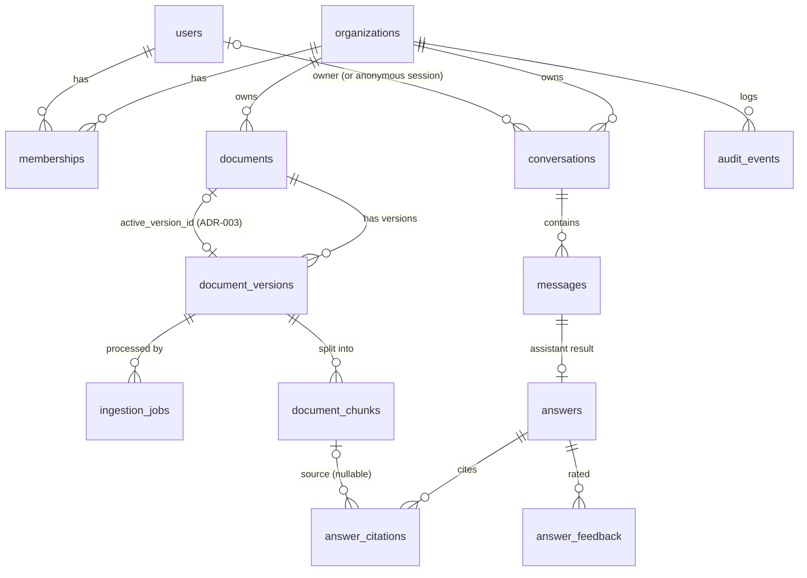
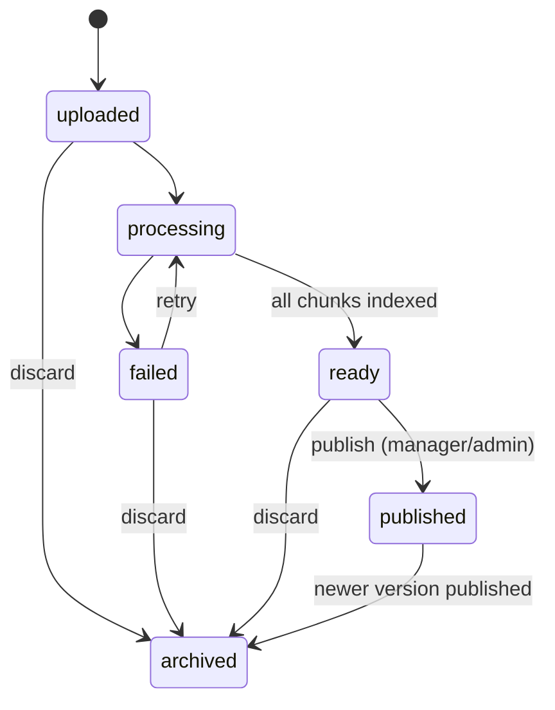

# KnowledgeAI data model (blueprint §6, implemented)

Code: [`backend/app/db/models.py`](../backend/app/db/models.py) · migration: [`backend/migrations/versions/`](../backend/migrations/versions/) ·
Chroma: [`backend/app/integrations/chroma.py`](../backend/app/integrations/chroma.py) · lifecycle: [`backend/app/services/versions.py`](../backend/app/services/versions.py).
Decisions: ADR-002, ADR-003, ADR-010, ADR-011 in [architecture.md](architecture.md).

## 1. Entity relationships (P0, migrated)

Outside the tenant model: `worker_heartbeats` (one row per worker process: last beat, jobs processed, the claimable
queue's depth and oldest wait). It describes processes, not tenant data, so it has no `organization_id` and no RLS; only
`GET /health` reads it (ADR-020).

Also outside it, for operations (ADR-021): `request_metrics` (key: minute, method, route *template*, status; `count`
and `total_ms`, summed over API processes by upsert; no IDs or query strings) and `alert_events` (rule, severity
`warning|critical`, summary, details, fired/resolved times, notified; a partial unique index allows one open alert per
rule). Both are deleted after `METRICS_RETENTION_DAYS` (90; open alerts are kept). Only the metrics API reads them.

## 2. Conventions

| Rule | How |
| --- | --- |
| Keys | UUIDv7 via Postgres 18's native `uuidv7()`: time-ordered, so no index fragmentation (Postgres skill: schema-primary-keys) |
| Types | `text`, `timestamptz`, `jsonb`, `text[]`; no `varchar(n)`, no naive timestamps |
| Allowed values | `text` + `CHECK`, generated from Python `StrEnum`s, so models and DB can't disagree |
| Tenant integrity | Every tenant row has `organization_id`; children reference parents by **composite FK** `(organization_id, parent_id)`, so cross-tenant links are impossible at the database level |
| Tenant isolation | Row-level security on 9 tables, forced; the app connects as a non-owner role (ADR-011) |
| Indexes | Every FK column is indexed (directly or as a leading column); partial indexes for the hot filters (`ix_documents_answerable`, `ix_ingestion_jobs_claimable`) |
| Naming | Deterministic constraint names (`uq_…`, `fk_…`, `ck_…`, `ix_…`) so migrations and errors are readable |

## 3. Delete behaviour (§6.1 "designed explicitly")

| Parent → child | On delete | Why |
| --- | --- | --- |
| organizations → anything | RESTRICT | Tenants are never deleted by cascade; offboarding is a deliberate purge procedure |
| users → memberships | CASCADE | Access ends with the identity |
| users → conversations | CASCADE | A person's chats are their personal data |
| users → documents/versions `created_by`, feedback `user_id` | SET NULL | Keep the content and statistics, drop the link to the person |
| audit_events → users | *(no FK)* | The actor is a snapshot (`actor_user_id`, `actor_label`); history is never rewritten |
| documents → document_versions → chunks, jobs | CASCADE | Run only by the purge, after vectors and files are deleted (§6.3) |
| document_versions ← documents.active_version_id | NO ACTION | Can't delete the published version without unpublishing first |
| conversations → messages → answers → citations, feedback | CASCADE | Deleting a conversation removes all of its content (§6.1): the owner's "Delete chat" / "Clear history", and the retention job (ADR-019) |
| answers → answer_reviews | CASCADE | A review decision goes with its answer (deletion, retention) |
| documents → answer_reviews `document_id`; customers / conversations → support_tickets | SET NULL (only the id column) | The decision or ticket stays; only the link goes |
| document_chunks / document_versions → answer_citations | SET NULL (only the id column) | The citation row (position, pages) stays for audit; the purge also clears its `quote` |

## 4. Integrity rules enforced by the database

- `(document_id, version_number)` unique; `(document_id, checksum)` unique (the same file twice is a duplicate, not a version).
- At most **one published version per document** (partial unique index).
- `documents.active_version_id` must belong to the same document (composite FK).
- Versions are **immutable** once uploaded (trigger): file, number and owner can't change; only status, counts and publish time can.
- `document_chunks.chroma_id` must equal `{organization_id}:{version_id}:{chunk_index}` (CHECK).
- `answers`: `answer_status = 'answered'` exactly when `grounded = true` (CHECK). Statuses: `answered`,
  `insufficient_evidence`, `escalated` (P1), `error` (provider/retrieval failure; the question is still saved), `direct`
  (fixed replies: greeting, support handoff, order lookup not available; ADR-017).
- `answers` trace columns (§13, IDs only, never retrieved text): `intent`, `graph_path` (nodes in order),
  `retrieved_chunk_ids` (Chroma IDs in rank order: the evaluation runner scores recall@k from these), `retrieval_attempts`
  (0-2, CHECK), `timings` (ms per node), plus `request_id`, `trace_id`, `latency_ms`; the model ID is on the message.
  ADR-021 adds `caller_role` (a role surrogate, never an identity: `anonymous`, `customer`, `employee`, `manager`,
  `admin`, `service`, `evaluation`; CHECK; NULL on answers from before it existed), `error_code` (the error's kind,
  e.g. `TIMEOUT`, `PROVIDER_FAILED`, `CITATIONS_INVALID`, `NO_RESULTS`, `WEAK_EVIDENCE`; never a message) and `token_usage` (jsonb: `embedding`,
  `prompt`, `completion`, `llm_calls`, `estimated_cost_usd`). Rows with `caller_role = 'evaluation'` are left out of
  analytics and metrics.
- `audit_events` is append-only (trigger blocks UPDATE and DELETE).
- `documents.tags`: at most 10 (`cardinality(tags) <= 10`, CHECK); stored lower-case and unique by the API. Tags are an
  admin filter only: they are not in Chroma and never affect retrieval.
- Search metadata (§2.2 P1, ADR-028): `documents.brand`, `department`, `language` (ISO 639-1, default `en`, CHECK) and
  `effective_date`. Postgres only, so managers edit them in place (`PATCH /documents/{id}`, audited); `brand` also
  narrows the assistant's search. `product_model` and `audience` are copied into Chroma, so they are set at upload only.
- `document_chunks.text` (ADR-028): the chunk's redacted text, for keyword search; `search_vector` is generated from
  `section` and `text` (GIN index). Deleted with the row, so a purge removes it. NULL on rows written before ADR-028
  until `python -m app.ingestion.rebuild` fills them.
- Emails are unique case-insensitively (`lower(email)` unique index); a user has a password hash or an external subject.

## 5. Row-level security (ADR-011)

Database roles: the owner runs migrations only; the API connects as `knowledgeai_app`; the worker as
`knowledgeai_worker`, a member of `knowledgeai_app` (same privileges and the same policies, its own login, ADR-025).
Neither has BYPASSRLS. Local: `infra/docker/postgres/init/`; managed databases: `infra/deploy/postgres/roles.sql`.

| RLS (forced) | No RLS, and why |
| --- | --- |
| documents, document_versions, document_chunks, conversations, messages, answers, answer_citations, answer_feedback, audit_events; products, customers, orders, order_items, support_tickets, ticket_notes (ADR-029); answer_reviews (ADR-030); repairs, account_grants (ADR-031) | `organizations`, `users`, `memberships`: read during login, before a tenant is known · `ingestion_jobs`: the worker claims jobs across tenants, then sets the tenant from the job · `worker_heartbeats`, `request_metrics`, `alert_events`: process and service health, no tenant data |

Policy on each table: `organization_id = (SELECT app_current_org())`, for both reads and writes.
`app_current_org()` reads the transaction-local setting `app.organization_id`. If it is unset, it returns NULL and every policy is false
(**fail closed**). Code sets it with `app.db.session.tenant_session(org_id)`.

## 6. Chroma (§6.2, ADR-010)

- **One shared collection** `knowledge_chunks`, cosine space, embeddings always supplied by us (no default model download).
- **ID:** `{organization_id}:{version_id}:{chunk_index}`: deterministic, tenant-prefixed, idempotent on retry.
- **Metadata (scalar only, strict schema):** `organization_id`, `document_id`, `document_version_id`, `title`, `source_type`, `page_start`,
  `page_end`, `section?`, `audience`, `product_model?`, `language`. `None` values are omitted (Chroma rejects them); unknown keys are rejected.
- **Query:** only through `KnowledgeIndex.query(principal, embedding, active_version_ids)`. The filter is `org ∧ audience ∈ allowed ∧
  version ∈ active`, and every hit is re-checked in Python before it is returned (§6.3 post-filter). An empty active list returns `[]`
  without querying.
- **Authorization never relies on Chroma alone:** active versions and audiences come from Postgres; Chroma metadata only narrows the search.
- **Embedding fingerprint (ADR-013):** the collection metadata records `knowledgeai_embedding_model` and
  `knowledgeai_embedding_dimension`. Opening it with other settings raises `IndexMismatch`; a model change means a new
  `CHROMA_COLLECTION` and a re-index from the stored originals.

## 7. Version lifecycle (§6.3)

| Rule | Implementation |
| --- | --- |
| New uploads aren't searchable | Only `documents.active_version_id` versions are passed to retrieval |
| Publish only fully indexed versions | `publish_version` requires `ready` and `expected = indexed = Postgres chunk rows = Chroma count` |
| Atomic switch | One transaction with row locks: archive the old version → publish the new one → move the pointer → audit row |
| Archived versions | Visible to managers and admins only (preview and audit). Never answerable. Rollback = upload/publish again as a new version |
| Duplicates | Same file on the same document: rejected by the DB. Same file on another document: `find_duplicates` lets the upload UI warn |
| Delete | Admin soft-deletes (stops answering at once) → purge removes vectors, stored files, rows; citations keep position/pages, lose link and quote |
| Reconciliation | `reconcile_version` compares expected / Postgres / Chroma counts. The worker runs `reconcile_all` every `RECONCILE_INTERVAL_SECONDS` (requeue expired jobs, delete orphan files and vectors, report drift) |

### Ingestion jobs (§7.4, ADR-008, ADR-012)

| Column | Meaning |
| --- | --- |
| `state` | `queued → parsing → chunking → embedding → indexing → done`, or `failed` / `cancelled` (mapping to the plan's states: `docs/architecture.md` §2) |
| `attempts`, `max_attempts` | Incremented on each claim; the claimed number fences every later write (ADR-012). Default 3 |
| `run_after`, `locked_until` | Backoff for retries; the lease. Reconciliation requeues jobs whose lease expired |
| `error_code`, `failed_stage` | Stable code (`app/ingestion/errors.py`, mapped to admin copy) and the stage it happened in |
| `cancel_requested` | Set by cancel/delete; the worker stops at the next stage boundary |
| `stage_timings` | Milliseconds per stage plus `embedding_tokens` (§7.4 latency by stage) |
| `warnings` | Non-fatal findings for admins: `REDACTED` counts, `PAGES_WITHOUT_TEXT`, `PAGES_LOW_CONFIDENCE` |

At most one unfinished job per version (partial unique index `uq_ingestion_jobs_one_active_per_version`). A manual retry
creates a new job after the old one ended. `ingestion_jobs` has no RLS (the worker claims across tenants), so every API query
on it filters `organization_id` explicitly (`app/services/documents.py`), and a cross-tenant job ID returns 404.

Upload rules: allowlisted `.pdf`/`.docx`/`.txt` whose contents match the extension; no executables, macros, encrypted or
corrupt files; size, PDF page and per-tenant concurrency limits from settings; storage key `{org}/{document}/{version}.ext`
(never the user's file name); SHA-256 checksum; malware scan before storage (ADR-015).

## 8. Personal data (§6.1 "protect stored personal data")

| Data | Where | Protection now | Still to decide / do |
| --- | --- | --- | --- |
| Email, display name | `users` | Least-privilege app role; never in Chroma or traces | Retention after account closure (P1) |
| Password | `users.password_hash` | argon2id hash only; never logged or returned | — |
| Customer questions in analytics | `messages.content` via `GET /admin/analytics` | Emails, phones, order numbers, cards and IDs redacted server-side (`app/core/privacy.py`); full conversations need `conversations:read` (no role has it in the MVP) | Name/address detection (NER, P1) |
| Secrets / IDs inside uploads | Document text | Redacted before chunking: private keys, API keys and tokens, JWTs, Luhn-valid card numbers, US SSNs. Only counts are recorded | Extend patterns per market (e.g. Bangladeshi NID) when Bangla content arrives |
| Conversation text | `messages.content` | RLS by tenant; deleted with the conversation (by its owner at any time, or after `CONVERSATION_RETENTION_DAYS` of inactivity, ADR-019); never written to logs (ADR-020) | Decided (ADR-027): 180 days of inactivity; prompts reach only the local model, traces hold IDs |
| Feedback notes | `answer_feedback.note` | RLS; 2,000-char limit | Same retention as conversations |
| Anonymous sessions | `conversations.session_ref` | Stored as a hash, not the raw cookie | — |
| Customer contact info | `customers.email_hash`, `phone_hash` | Never stored readably: HMAC-SHA256 of the normalized email / phone, keyed by `CUSTOMER_LOOKUP_SECRET` (ADR-029). Enough to verify, useless for contacting or listing customers. Staff see only `external_ref` | Decided (ADR-029); replaces the planned column encryption |
| Order and repair lookups | `audit_events` (`order.lookup.*`, `repair.lookup.*`) | Number and role only, never the contact typed | — |
| A customer's records in answers | `messages.content` of account answers (ADR-031) | Only the caller's own records, through the local model; deleted with the conversation (ADR-019) | — |
| Exports and the review queue | CSV downloads (`/admin/exports/…`), `/admin/reviews` | Managers and admins only; the same redaction as the dashboard; ticket summaries and conversations never exported; each download audited (ADR-030) | Name detection (NER, P1) would cover names too |
| Ticket summaries | `support_tickets.summary`, `ticket_notes.body` | RLS; staff only; drafted from the employee's own conversation, reviewed before saving; a deleted conversation leaves the ticket | Retention for resolved tickets (P1) |
| Disk | Postgres volume | — | Encrypted storage in staging/production (M7) |

## 9. Orders and support tickets (P1, migrated: US-05 and ticketing, ADR-029)

Fictional data only (`python -m app.cli.seed_orders`). Every table has `organization_id`, composite tenant foreign
keys and forced RLS like the P0 tables. Orders are the source of truth for order questions and are **never** put in
Chroma (§2.4).

| Table | Key fields | Notes |
| --- | --- | --- |
| `products` | `sku`, `name`, `brand?`, `category?`, `product_model?`, `price_cents` ≥ 0 | Unique `(organization_id, sku)` |
| `customers` | `external_ref` ("CUST-00042"), `user_id?`, `email_hash`, `phone_hash?` | Hashes CHECKed as 64 hex characters; `user_id` links a TechCare account (`GET /orders/mine`); a deleted user unlinks (`SET NULL`) |
| `orders` | `customer_id`, `order_number` ("TC-123456"), `status` CHECK, `delivery_method` CHECK, `placed_at`, `shipped_at?`, `delivered_at?`, `expected_on?`, `carrier?`, `tracking_number?`, `total_cents` | Unique `(organization_id, order_number)`; read only after verification (US-05) or by the linked customer |
| `order_items` | `order_id`, `product_id`, `quantity` > 0, `unit_price_cents` | Deleted with the order |
| `support_tickets` | `number` (per organization, "T-0042"), `subject`, `summary`, `summary_drafted`, `status` CHECK, `priority` CHECK, `customer_id?`, `conversation_id?`, `order_number?`, `created_by?`, `assigned_to?`, `resolved_at?` | `resolved_at` set exactly when resolved (CHECK). Numbers are taken under an advisory lock. A deleted customer or conversation nulls only that link (`SET NULL (column)`, so `organization_id` stays) |
| `ticket_notes` | `ticket_id`, `author_id?`, `body` (1–4,000) | Deleted with the ticket |
| `repairs` (ADR-031) | `customer_id`, `order_id?`, `reference` ("RP-123456"), `product_name`, `reported_fault`, `diagnosis?`, `resolution?`, `status` CHECK, `store`, `under_warranty`, `cost_cents?`, `received_at`, `ready_on?`, `collected_at?` | Unique per org reference; `collected_at` set exactly when collected (CHECK); a deleted order only unlinks (`SET NULL (order_id)`) |
| `account_grants` (ADR-031) | `conversation_id`, `order_id?` or `repair_id?` (exactly one, CHECK), `expires_at` | A guest's verified record for one conversation; cascades with the conversation, order or repair |
| `orders.pickup_store`, `pickup_by` (ADR-031) | Store and last day a ready pickup is held | Only on pickup orders (CHECK) |
| `answer_reviews` (ADR-030) | `answer_id`, `status` CHECK (`resolved`, `dismissed`), `note?` (≤ 1,000), `document_id?`, `reviewed_by?`, `reviewed_at` | Unique per answer; no row = still open. Deleted with the answer |
