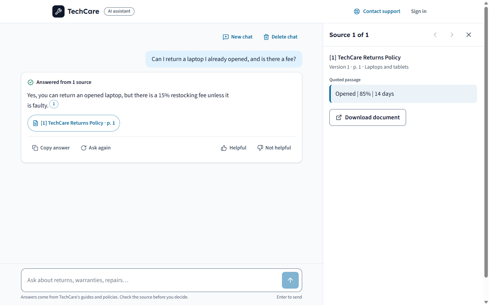

# §19 decisions and §20 first issues: evidence

Date: 2026-10-20. Plan sections: [§19](../IMPLEMENTATION_PLAN.md#19-explicit-decisions-to-make-before-major-coding),
[§20](../IMPLEMENTATION_PLAN.md#20-suggested-issues-for-first-coding-session). Decisions: ADR-026 and ADR-027 in
[architecture.md](../architecture.md) (§8 lists each answer).

## 1. What the owner decided

| §19 question | Answer | ADR |
| --- | --- | --- |
| Authentication and hosting | App-managed sign-in; one Linux VM with Docker Compose | 014, 027 |
| Chroma layout | One shared collection, mandatory tenant filter | 010 |
| LLM, embeddings, context, spend | Local Qwen3-4B-Instruct-2507 (Q4_K_M) and nomic-embed-text-v1.5 (Q8_0) on llama.cpp; ≤ 6,000 evidence tokens; **$0**, no paid API | 026 |
| Text PDFs or scans | Text PDFs only; OCR is P1 | 027 |
| Upload size and retention | 20 MB / 300 pages; chats 180 days; deleted documents purged after 30 days | 019, 027 |
| Who publishes and sees analytics | Managers and admins | 027 |
| Anonymous or signed in | Anonymous chat allowed; history only when signed in | 017, 027 |
| Version activation and index repair | Active versions from Postgres; reconcile and rebuild | 002, 003 |
| Adequate evidence and escalation | Deterministic evidence gate and citation validation; Contact support | 016, 024 |
| Personal data in prompts and traces | The question as typed plus authorized chunks, to the local model only; traces hold IDs | 020, 026, 027 |

The owner's words on models: no paid AI subscriptions, APIs or credits; download a suitable model from Hugging Face
into an `LLM` folder in the project and answer with it locally.

## 2. What was built for it

- `LLM/models.json` pins both files: repository, revision, size and SHA-256. `LLM/README.md` explains them.
- `scripts/download_models.py` streams the files, resumes partial downloads, verifies each hash and renames a bad
  file to `.bad`. `--check` verifies only. Both files are downloaded and verified (2.64 GB in `LLM/models/`,
  git-ignored).
- `compose.yaml` adds the `llm` and `embedder` services (llama.cpp `server-b11580`, profiles `llm` and `app`).
  `compose.gpu.yaml` switches them to the CUDA image. The containerized api and worker use them automatically.
- The backend has a provider `local` (`app/config.py`, `app/rag/llm.py`, `app/ingestion/embeddings.py`):
  - It uses the OpenAI-compatible adapters with a base URL and no key.
  - The embedder adds the query and document prefixes.
  - It is accepted in staging and production without a key.
- Two faults found on the first local golden run and fixed (ADR-026):
  - The prompt never said when to answer, so the model refused correct answers.
  - The model omits inline markers, so the validator marks the answer with its validated citations.
- `test_adversarial` can red-team a real model: set `RED_TEAM_LLM_URL`.
- Docs updated:
  - Status and setup: README, CLAUDE.md, `.env.example`.
  - Deployment: deployment.md (§1a the VM, CPU time limits).
  - Results: evaluation-report.md (§4a), evaluation.md.
  - Risk and data: risk-register.md, threat-model.md, data-model.md, definition-of-done.md.
  - Versions and layout: dependency-versions.md, repository.md.

## 3. Automated tests

| Test | Proves |
| --- | --- |
| `test_config::test_local_models_need_no_key_and_are_accepted` | `local` passes the staging/production guards with no key |
| `test_config::test_local_models_need_their_server_url` | `local` without `LLM_BASE_URL` / `EMBEDDING_BASE_URL` is refused |
| `test_embeddings::test_the_local_embedder_uses_its_server_no_key_and_task_prefixes` | Calls the configured server, sends no Authorization header, prefixes queries and documents differently |
| `test_rag::test_the_local_model_is_called_on_its_own_server_without_a_key` | The chat adapter calls the local URL |
| `test_rag::test_an_answer_without_markers_rests_on_all_its_citations` | An answer without inline markers gets its validated citations appended, e.g. `[1][2]` |
| `test_adversarial` (5 tests) with `RED_TEAM_LLM_URL` | System prompt never disclosed, document instructions stay data, contradicting sources never blended: **5 / 5 on the local model** ([19-red-team-local-model.txt](19-red-team-local-model.txt)) |
| golden-v1 gates on the local models | G1 98/98, G3 0/36, G4 103/103, G5 0/96, G6 0/12 (`evaluation/reports/golden-v1-local.json`) |

The existing suite still runs on the fake models (`.env` keeps `LLM_PROVIDER=fake`), so it stays offline and
deterministic.

## 4. Manual tests

1. **Download and verify:** `python scripts/download_models.py`, then `--check`. Both files report `ok` with
   their SHA-256.
2. **golden-v1 on the local models** (GPU, 142 cases): every gate passes. 89 / 98 answerable questions match word
   for word: 7 misses are correct paraphrases, 1 is incomplete (G049), 1 refuses (G082). All 36 unanswerable
   questions are refused. Full answer p50 1.86 s and p95 2.82 s. Details: [evaluation-report.md §4a](../evaluation-report.md).
   G2 sheet: `evaluation/audits/golden-v1-local-g2.md` (30 claims; pre-screen 24 supported, 6 to check; a person
   still has to fill it in).
3. **CPU speed** (the VM case; GPU servers stopped so the Docker VM had its memory): about 8 tokens/s generation
   and 65–90 tokens/s prompt processing, i.e. 15–30 s per answer. Hence the raised time limits in deployment.md §1a.
   A first reading of 0.3–0.5 tokens/s was memory pressure from the GPU container still running, not the model.
4. **The whole system in containers with the local models:**
   - Started with `docker compose -f compose.yaml -f compose.gpu.yaml --profile app up -d --build`; every service
     was up.
   - The index `knowledge_chunks_local_v1` was built with `app.ingestion.rebuild`: 52 versions from the host
     run and 3 uploaded through the containers (their originals are in the `uploads` volume).
   - As a guest on `http://127.0.0.1:13000/chat`, asked "Can I return a laptop I already opened, and is there a fee?"
   - Answer: "Yes, you can return an opened laptop, but there is a 15% restocking fee unless it is faulty."
     The answer shows "Answered from 1 source", and the source panel shows "[1] TechCare Returns Policy · p. 1"
     with the quoted table row.
   - The llama.cpp log shows the request: 458 prompt tokens, 104 generated at 50 tokens/s.

## 5. §20: the first ten issues

All ten were built in earlier sections. The GitHub issues themselves are the owner's to create.

| # | Issue | Evidence |
| --- | --- | --- |
| 1 | setup: FastAPI + Next.js + Docker Compose | [5.1-local-stack.md](5.1-local-stack.md) |
| 2 | db: organizations/users/documents/versions/jobs migrations | [6-data-model.md](6-data-model.md) |
| 3 | auth: tenant and role dependencies | [7-ingestion.md](7-ingestion.md), [9-api-spec.md](9-api-spec.md) |
| 4 | ingest: PDF/TXT parser preserving pages | [7-ingestion.md](7-ingestion.md) |
| 5 | ingest: chunk, embed, upsert with deterministic IDs | [7-ingestion.md](7-ingestion.md) |
| 6 | rag: tenant-aware retriever and LangGraph workflow | [8-rag-workflow.md](8-rag-workflow.md) |
| 7 | rag: structured citations and insufficient evidence | [8-rag-workflow.md](8-rag-workflow.md) |
| 8 | frontend: document manager and sourced chat | [10-ui.md](10-ui.md) |
| 9 | test: evaluation dataset and access-control regression tests | [12-evaluation.md](12-evaluation.md) |
| 10 | integration: service-auth knowledge endpoint for the voice project | [9-api-spec.md](9-api-spec.md), [contracts/](../contracts/) |

## 6. Still open

- **G2 grounding audit:** needs a person, on both the substitute and the local run.
- **Concurrent load test on the local models:** not run yet. llama.cpp serves 2 requests at a time (`--parallel 2`),
  so concurrency will queue.
- **golden-v2:** should accept paraphrases, so wording differences stop counting as misses.
- **The VM:** not provisioned.
